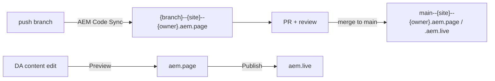

# Release: previews, PRs, merge, publish, submit

## Contents

- [How code and content reach users](#how-code-and-content-reach-users)
- [Branch preview](#branch-preview)
- [Pull request](#pull-request)
- [Merge and after](#merge-and-after)
- [Fresh-install test](#fresh-install-test)
- [Contest or nomination entry](#contest-or-nomination-entry)
- [After launch](#after-launch)

## How code and content reach users



- **Code** (`tools/`, `blocks/`, `scripts/`) ships when it is **pushed**. Every branch gets its own preview host. Merging to `main` ships to the production hosts.
- **Content** (pages and the config sheets in da.live) ships separately, with **Preview** or **Publish**, or with the admin API: `POST https://admin.hlx.page/preview/{owner}/{site}/main/{path}`.
- **Config is content.** A new `library` row is live as soon as it is saved in `da.live/config`, for every branch. Add it only when the code is on `main`, or point its `path` at the branch host while you test.
- Everything committed is served, except `.hlxignore` matches. Check that `docs/`, `test/` and `worker/` stay hidden: `curl -sI https://{branch}--{site}--{owner}.aem.page/tools/{name}/test/lib.test.js` should return 404.

## Branch preview

1. Push the branch. Code Sync usually updates `{branch}--{site}--{owner}.aem.page` within a minute.
2. Open `https://{branch}--{site}--{owner}.aem.page/tools/{name}.html?demo=1`.
3. Test inside EW with the branch code: `https://da.live/edit#/{org}/{site}/{page}?ref={branch}`.
4. If an asset is stale, add `?nocache={n}` or wait. Code Sync errors appear in the GitHub app's check on the commit.

Branch names become hostnames. Use lowercase letters, digits and hyphens. Keep the whole `{branch}--{site}--{owner}` label within 63 characters.

## Pull request

Fill in the repository's PR template. If `.github/pull_request_template.md` exists, keep its headings. The aem-boilerplate template asks for:

```markdown
Fix #{issue}

Test URLs:
- Before: https://main--{site}--{owner}.aem.live/tools/{name}.html?demo=1
- After: https://{branch}--{site}--{owner}.aem.page/tools/{name}.html?demo=1
```

- **A PR without a `{branch}--{site}--{owner}.aem.page/{path}` link gets rejected.** Reviewers expect it, and the AEM GitHub bot uses these URLs for its PageSpeed check. Link the exact page that shows the change.
- If there is no issue, write `Fix #` with a short "No issue: {why}" line rather than deleting the line.
- Add a **What changed** list, an **How I tested** list with each command and its result (`npm run lint`: passed; `npm test`: 263 passed), and screenshots or a short GIF for UI changes.
- Keep PRs to one extension or one feature, so the PSI and Code Sync checks are meaningful.

## Merge and after

1. Squash-merge when checks pass. The PageSpeed check runs on the test URL, so make sure that page loads.
2. Check `https://main--{site}--{owner}.aem.page/tools/{name}.html?demo=1`, plus `marketplace.png` and `icon.svg`.
3. Change any README, nomination or Marketplace links that still point at the branch to `main`.
4. Preview and publish the content the README links to, such as the demo page or the page created by the extension.
5. Delete the branch if nothing else depends on it. Its preview host disappears, so check no link still uses it.

## Fresh-install test

Do this before you submit. It is the test of "anyone can deploy without help".

1. Use a second site or org (or a fresh `aem-boilerplate` copy) **with no config**.
2. Follow only the README:
   - copy the code or point at the hosted page;
   - add the config row;
   - deploy the worker to a new Cloudflare account, or with a new name.
3. Check that:
   - with no `{name}` sheet, the panel shows the setup view or demo, not an error;
   - with config, the live flow works end to end;
   - a caller from a non-allowed org gets a clear 403 from the worker.
4. Fix any step you had to guess in the README.

## Contest or nomination entry

Start from `assets/nomination.md`. Write it for judges who score these factors:

| Factor | What to show | Where |
|---|---|---|
| **Author value** (usually weighted highest) | The manual work removed, in minutes or steps. The author's words, not the tech | One-liner, "The problem" |
| **Demonstrability** | Problem → clicks → result in 3 steps; a 2-minute video; a Try URL with no account | Workflow, links |
| **Third-party fit** | A non-Adobe service, a real API and a two-way flow (in and out) where possible | Third party |
| **Polish and completeness** | Demo mode, errors handled, README, Marketplace image, tests, security | "What makes it different" |

- **One-line idea:** `**{Title}:** {verb} {outcome} {where/when}, {differentiator}.`
- Mention **why it matters to customers**. If a customer described the pain, say "based on customer feedback" without naming them.
- Link to `main`: the README, the Try URL, the video and a real result page.

## After launch

- Watch the repo's GitHub issues. Add each new question to the README's Troubleshooting table.
- Keep the demo data and the demo site published. A broken Try URL kills the listing.
- When the EW SDK adds a capability, such as replace or the live document, gate it with `capabilities` and keep the fallback.
- Rotate worker secrets if a token may have leaked (`wrangler secret put`). No code change is needed.
