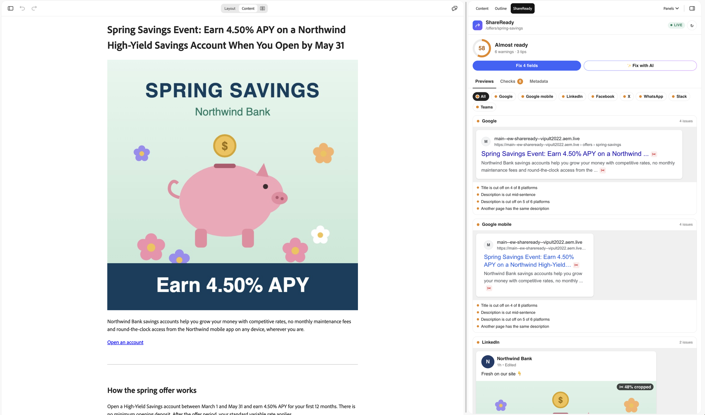
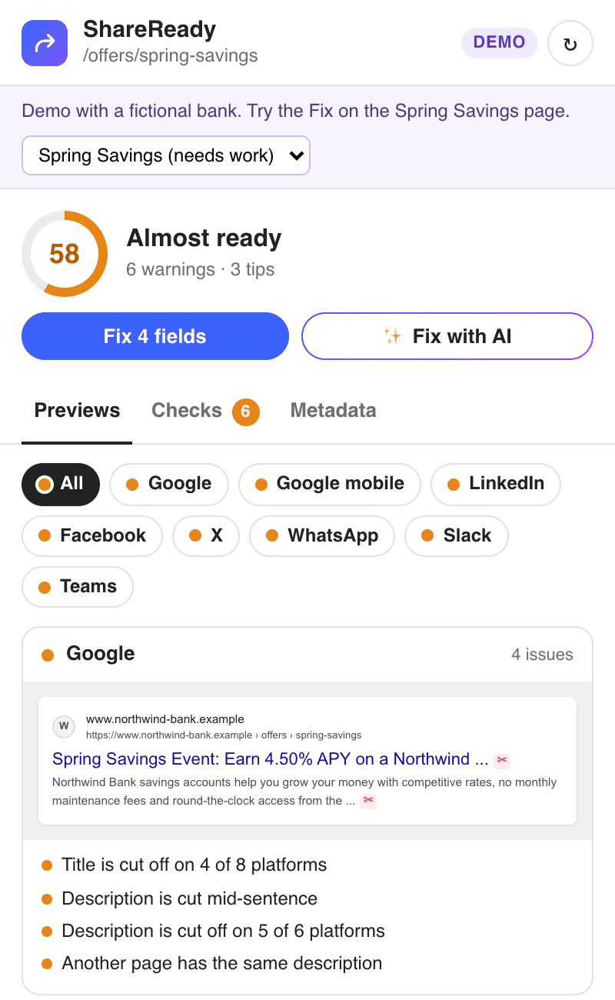
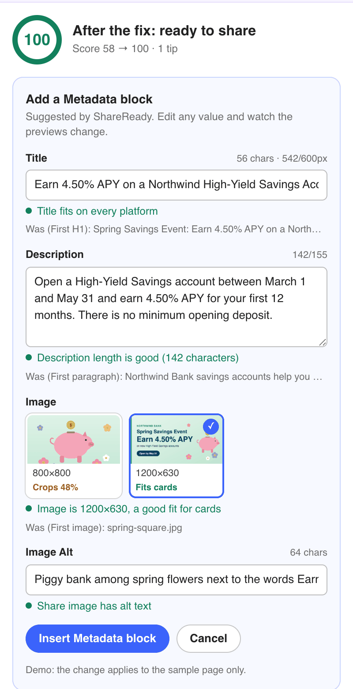
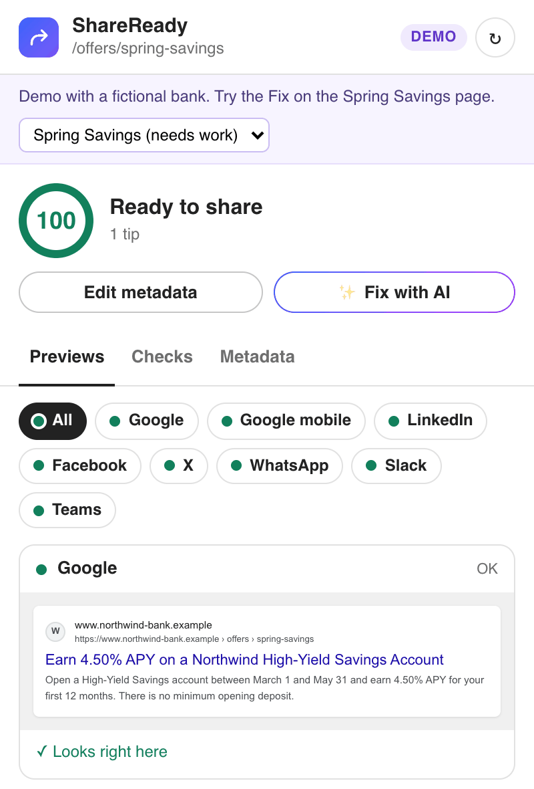
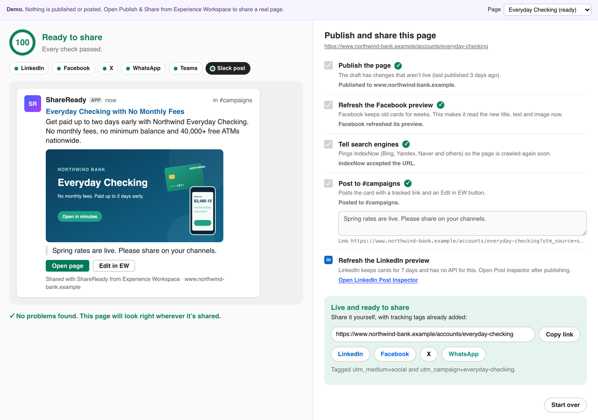
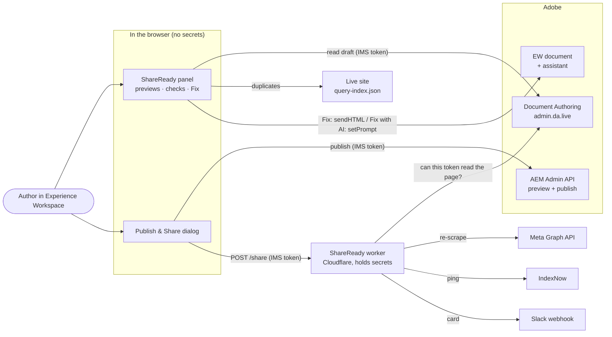
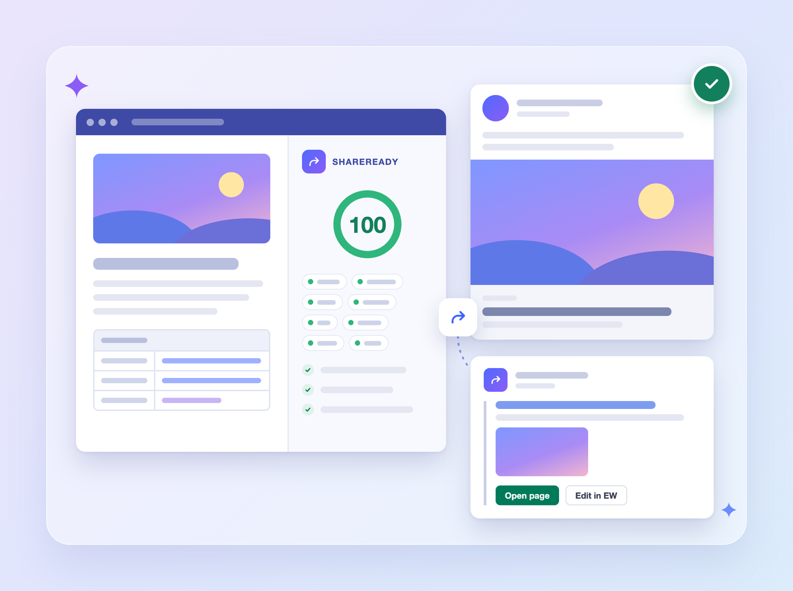

# ShareReady

**See how a page will look when it's shared, fix it in one click, then publish and share it in one step from Experience Workspace.**

ShareReady is an Experience Workspace (EW) extension for AEM Edge Delivery Services. While you write, it shows live link previews for Google, LinkedIn, Facebook, X, WhatsApp, Slack and Teams. It checks the title, description and share image against each platform's real limits, and writes the Metadata block for you. When the page is ready, **Publish & Share** publishes it and refreshes Facebook's cached card. It also notifies search engines through IndexNow and posts a share card to your team's Slack channel.



<table>
  <tr>
    <td width="33%"></td>
    <td width="33%"></td>
    <td width="33%"></td>
  </tr>
  <tr>
    <td align="center"><b>1. Spot</b>: the title and description are cut off</td>
    <td align="center"><b>2. Fix</b>: review the suggested Metadata block</td>
    <td align="center"><b>3. Ready</b>: every platform looks right</td>
  </tr>
</table>



- **Try it now, no setup:** [panel demo](https://main--ew-shareready--vipult2022.aem.live/tools/shareready.html?demo) · [Publish & Share demo](https://main--ew-shareready--vipult2022.aem.live/tools/shareready/publish.html?demo)
- **Third parties:** Google, LinkedIn, Facebook (Meta Graph API), X, WhatsApp, Slack (incoming webhook), Microsoft Teams, IndexNow (Bing, Yandex and others)
- **Cost:** free. The panel needs nothing. Publish & Share uses free tiers of Cloudflare Workers, Slack and Meta for Developers.

## Contents

- [Why](#why)
- [What it does](#what-it-does)
- [Try it](#try-it)
- [Install](#install)
- [Configuration](#configuration)
- [Set up the worker](#set-up-the-worker)
- [Security](#security)
- [How it works](#how-it-works)
- [Limits](#limits)
- [Troubleshooting](#troubleshooting)
- [Development](#development)
- [Marketplace listing](#marketplace-listing)

## Why

Most people meet a page through a link card, not the page itself. In Edge Delivery Services that card comes from the page's Metadata block, or from defaults (the first heading, paragraph and image) when there isn't one. Authors can't see the card while they write, so it's easy to ship:

- a title that Google cuts off at about 600 pixels,
- a description that is really the first paragraph of body copy,
- a share image that is too small, the wrong shape, or missing, and
- a card that Facebook and LinkedIn keep showing in its *old* version after you fix it, because they cache it.

Then someone still has to tell the team the page is live, usually by pasting a bare link into Slack.

ShareReady moves all of this into the editor: **see the card, fix it, publish, refresh the caches and announce it, without leaving EW.**

## What it does

### Live previews

The ShareReady panel opens from the EW Extensions menu. It renders the current page as it will appear on:

| Platform | What's shown |
| --- | --- |
| Google (desktop and mobile) | Search result with title and description truncated at the real pixel widths |
| LinkedIn, Facebook, X | Feed post with the link card |
| WhatsApp | Chat message with the link preview |
| Slack, Teams | Message unfurl |

The panel reads the draft you're editing, not the published page. It uses the same rules as Edge Delivery Services:

- **Title:** the Metadata `Title`, otherwise the first H1.
- **Description:** the Metadata `Description`, otherwise the first paragraph.
- **Image:** the Metadata `Image`, otherwise the first image.

It also respects `og:*` and `twitter:*` overrides in the Metadata block. Text is measured with each platform's font and width, so "cut off" means cut off on that platform, not "over N characters". The panel re-checks as you type, a few seconds after EW saves the draft.

### Checks and score

Every check names the platforms it affects and explains what to change. The score starts at 100 and loses 18 points per error and 7 per warning.

| Area | Checks |
| --- | --- |
| Title | Missing, shorter than 15 characters, cut off (per platform), duplicates another page, came from the H1 rather than the Metadata block |
| Description | Missing, shorter than 70 characters, cut off (Google shows about 155), repeats the title, duplicates another page, taken from the first paragraph |
| Share image | Missing, broken, SVG (not supported by social networks), too small for a large card (shown as a thumbnail, using each platform's own minimum), under 1200 px wide (soft on high-DPI screens), far from 1.91:1 (cropped), **private link** (a typed `content.da.live` URL that social networks can't load) |
| Alt text | Missing, or seems to describe a different image |
| Page | `noindex` set, more than one Metadata block, no H1 or several H1s, no site name |

Duplicate titles and descriptions are found through the site's `query-index.json`. That check is skipped, with a note, if there is no index.

### One-click Fix

**Fix N fields** opens a short review form. It suggests a title, description, share image (picked from the page's own images) and alt text, shows what each one was before, and previews the result. Every field is editable. Then:

- **Insert Metadata block** adds the block at your cursor when the page doesn't have one.
- **Update Metadata block** replaces the existing block in EW. If asked, double-click a word in the old block first, so ShareReady knows which table to update. Rows it doesn't manage (such as `Template` or `Tags`) are kept.
- **Copy the table instead** puts the new block on the clipboard, ready to paste over the old one. This is the fallback in editors that can't update a table from a panel.

The share image is inserted as a real picture, not a typed URL. When the page is previewed, Edge Delivery Services copies the picture to the public media bus, where Slack, LinkedIn and others can load it.

### Fix with AI

**✨ Fix with AI** sends a prompt to the EW assistant, built from the page and the failing checks. The prompt asks the assistant to:

- write or update the Metadata block: a title of at most 60 characters, a 120–155 character description, a wide (about 1.91:1) share image placed as a picture, and alt text, and
- draft share copy in its reply only, not in the page: a LinkedIn post, an X post and a one-line Slack announcement.

ShareReady re-checks the page as the assistant edits it. Checks that need new wording, such as a short description, have a **Rewrite with AI** link.

### Publish & Share

**Publish & Share** opens from EW's Prepare menu as a full-size dialog. It shows the card next to the steps it will run:

1. **Publish:** previews and publishes the page with your own EW permissions.
2. **Refresh Facebook:** asks the Meta Graph API to re-scrape the URL. Facebook otherwise keeps showing the old card for up to weeks.
3. **Notify search engines:** sends an [IndexNow](https://www.indexnow.org/) ping, which tells Bing, Yandex, Seznam, Naver and others to recrawl. If one endpoint is rate-limited, the worker tries the next.
4. **Post to Slack:** posts a card to your team channel with the page title, description and image. It includes a UTM-tagged **Open page** button, an **Edit in EW** button and an optional note. If Slack can't download the image, ShareReady posts the card without it and tells you.

You can untick any step. When the steps finish, the dialog shows:

- UTM-tagged share links for LinkedIn, Facebook, X and WhatsApp,
- a link to [LinkedIn Post Inspector](https://www.linkedin.com/post-inspector/), which refreshes LinkedIn's cache (LinkedIn has no API for this), and
- a link to the Facebook Sharing Debugger.

Steps 2–4 run on a small Cloudflare Worker that holds your Meta and Slack secrets. Without it, the panel, checks, Fix and publishing all still work; the dialog explains what's missing.

## Try it

Two demos run on sample Northwind Bank pages (a fictional brand). They don't need EW, sign-in or any setup:

| Demo | What to do |
| --- | --- |
| [Panel demo](https://main--ew-shareready--vipult2022.aem.live/tools/shareready.html?demo) | Pick **Spring Savings (needs work)**, click **Fix 4 fields**, review, then **Insert Metadata block**. Compare with **Everyday Checking (ready)**. |
| [Publish & Share demo](https://main--ew-shareready--vipult2022.aem.live/tools/shareready/publish.html?demo) | Click **Publish & share** to step through a simulated run. It makes no network calls to Meta, IndexNow or Slack. |

The demo site itself:

- Preview: https://main--ew-shareready--vipult2022.aem.page/
- Live: https://main--ew-shareready--vipult2022.aem.live/

## Install

This takes about five minutes and needs no code. You need an Edge Delivery Services site authored in Document Authoring (da.live) with Experience Workspace, and permission to edit the site config.

### Option A: use the hosted copy

Open your site config at `https://da.live/config#/{org}/{site}/` and add the following rows. If the `library` or `prepare` sheet doesn't exist yet, add it with the **+** button next to the sheet tabs.

**`library` sheet:** adds the ShareReady panel to the Extensions menu.

| title | path | icon | experience |
| --- | --- | --- | --- |
| ShareReady | `https://main--ew-shareready--vipult2022.aem.live/tools/shareready.html` | `https://main--ew-shareready--vipult2022.aem.live/tools/shareready/icon.svg` | `inline` |

**`prepare` sheet:** adds Publish & Share to the Prepare menu.

| title | path | icon | experience |
| --- | --- | --- | --- |
| Publish & Share | `https://main--ew-shareready--vipult2022.aem.live/tools/shareready/publish.html` | `https://main--ew-shareready--vipult2022.aem.live/tools/shareready/icon.svg` | `fullsize-dialog` |

Save the config and reload EW. Open any page, choose **Extensions → ShareReady**, and the panel appears next to the page.

The hosted copy runs entirely in your browser. It calls only Adobe's APIs, using your own sign-in, and your site's public `query-index.json`. Nothing is sent to a ShareReady server.

> [!NOTE]
> Publish & Share works straight away for **publishing**. The Facebook, IndexNow and Slack steps need [your own worker](#set-up-the-worker), because the secrets for those services must belong to you.

### Option B: host your own copy

To pin a version or change the code, copy these into your own site's repository:

```text
tools/shareready.html
tools/shareready/
```

Then use your own site's URLs in the `library` and `prepare` rows (for example `https://main--{site}--{org}.aem.live/tools/shareready.html`). The files are plain JavaScript, HTML and CSS with no build step and no dependencies.

### Optional: enable the duplicate check

The duplicate title and description check reads your site's query index. If you don't have one yet, add `/{org}/sites/{site}/content/query.yaml` through the [configuration service](https://www.aem.live/docs/admin.html) or [tools.aem.live](https://tools.aem.live/). Index at least `title` and `description`:

```yaml
version: 1
indices:
  default:
    include:
      - /**
    exclude:
      - /nav
      - /footer
      - /tools/**
    target: /query-index.json
    properties:
      title:
        select: head > meta[property="og:title"]
        value: attribute(el, "content")
      description:
        select: head > meta[name="description"]
        value: attribute(el, "content")
```

When you use the hosted copy (Option A), the panel reads your index from another origin, so allow it with a [custom header](https://www.aem.live/docs/custom-headers):

| URL | Key | Value |
| --- | --- | --- |
| `/query-index.json` | `access-control-allow-origin` | `*` |

When you host your own copy (Option B), the index is on the same origin and needs no header. See [Indexing](https://www.aem.live/developer/indexing) for more.

## Configuration

Every setting is optional. Add a sheet named **`shareready`** to your site config at `https://da.live/config#/{org}/{site}/`, with the columns `key` and `value`:

| key | Default | What it does |
| --- | --- | --- |
| `brand` | `og:site_name`, then the host | Name shown as the poster in the social previews |
| `x-handle` | none | Your X account, e.g. `@northwindbank`. Shown in the X preview and added as `via` to X share links. |
| `host` | `main--{site}--{org}.aem.live` | Public host for share links and checks, e.g. `www.example.com` once you have a production domain |
| `query-index` | `/query-index.json` | Path to the index used by the duplicate check |
| `worker-url` | none | Your worker URL, e.g. `https://shareready.example.workers.dev`. Turns on the Facebook, IndexNow and Slack steps. |
| `slack-channel` | The worker's `SLACK_CHANNEL` | Channel name shown in the dialog |
| `utm-source` | The platform (`linkedin`, `facebook`, `x`, `whatsapp`, `slack`) | Overrides `utm_source` for the Slack card |
| `utm-medium` | `social` | `utm_medium` on every share link |
| `utm-campaign` | The page's last path segment, e.g. `spring-savings` | `utm_campaign` on every share link |

The demo site uses:

| key | value |
| --- | --- |
| brand | Northwind Bank |
| x-handle | @northwindbank |
| slack-channel | #campaigns |
| utm-medium | social |
| worker-url | https://shareready.vipult2022.workers.dev |

## Set up the worker

The worker is a single Cloudflare Worker (about 480 lines, no dependencies) that holds your Meta and Slack secrets. It runs the Facebook, IndexNow and Slack steps for Publish & Share. Every service is optional: a step whose secret is missing is shown as "not set up" and the others still run.

This takes about 15 minutes. You need [Node.js](https://nodejs.org/) 20 or later and a free [Cloudflare account](https://dash.cloudflare.com/sign-up).

### 1. Get the code and sign in to Cloudflare

```sh
git clone https://github.com/vipult2022/ew-shareready.git
cd ew-shareready/worker
npx wrangler login
```

If the browser sign-in fails (for example with a "CSRF" or "state" error), run `npx wrangler login --browser=false`, open the printed URL yourself, and finish there.

If you've never deployed a worker, pick a free `workers.dev` subdomain under **Workers & Pages** in the Cloudflare dashboard. It can take a minute before the first HTTPS request works.

### 2. Edit `worker/wrangler.toml`

| Setting | Required | Value |
| --- | --- | --- |
| `ALLOWED_ORGS` | yes | Your DA org (`my-org`) or specific sites (`my-org/my-site`), comma-separated. The worker refuses everything else. |
| `INDEXNOW_KEY` | for IndexNow | A new key: `openssl rand -hex 16` |
| `SLACK_CHANNEL` | no | Channel name for messages, e.g. `#campaigns` |
| `ALLOWED_HOSTS` | no | Production hosts you share, e.g. `www.example.com`. `main--{site}--{org}.aem.live` and `.aem.page` are always allowed. |
| `ALLOWED_ORIGINS` | no | Browser origins that may call the worker. Default: `https://da.live`, `https://*.da.live`, `https://*.aem.page`, `https://*.aem.live`, `http://localhost:3000` |
| `INDEXNOW_ENDPOINT` | no | IndexNow endpoints to try in order. Default: `api.indexnow.org`, then `www.bing.com`, then `yandex.com` |
| `META_GRAPH_VERSION` | no | Pin a Graph API version such as `v24.0` |

IndexNow needs proof that you own the host. Add a file named `{key}.txt` that contains only the key to the **root of your site's repository**, then commit and push it. Check that `https://main--{site}--{org}.aem.live/{key}.txt` shows the key. Also make sure `.hlxignore` doesn't exclude it.

### 3. Deploy and add the secrets

```sh
npx wrangler deploy
npx wrangler secret put SLACK_WEBHOOK_URL   # from the Slack step below
npx wrangler secret put META_APP_ID         # from the Meta step below
npx wrangler secret put META_APP_SECRET
```

`wrangler secret put` prompts for the value, so it never lands in your shell history. Check the worker:

```sh
curl https://shareready.{your-subdomain}.workers.dev/status
# {"ok":true,"name":"shareready","features":{"facebook":true,"indexnow":true,"slack":true,"slackChannel":"#campaigns"}}
```

### 4. Connect it to your site

Add a `worker-url` row to the `shareready` sheet in your site config (see [Configuration](#configuration)), then reload EW. The Publish & Share dialog now lists the Facebook, IndexNow and Slack steps.

### Slack: incoming webhook

1. Go to [api.slack.com/apps](https://api.slack.com/apps) → **Create New App** → **From a manifest**, and pick your workspace (a free workspace is fine).
2. Paste this manifest:

   ```json
   {
     "display_information": { "name": "ShareReady" },
     "features": { "bot_user": { "display_name": "ShareReady", "always_online": false } },
     "oauth_config": { "scopes": { "bot": ["incoming-webhook"] } },
     "settings": {
       "org_deploy_enabled": false,
       "socket_mode_enabled": false,
       "token_rotation_enabled": false
     }
   }
   ```

3. **Install to Workspace**, then choose the channel to post to.
4. Copy the URL from **Incoming Webhooks** (`https://hooks.slack.com/services/…`). Run `npx wrangler secret put SLACK_WEBHOOK_URL` and paste it at the prompt.

A webhook posts to one channel. To post somewhere else, add another webhook and deploy a second worker, or change the secret.

### Meta (Facebook): re-scrape

1. Go to [developers.facebook.com/apps](https://developers.facebook.com/apps) → **Create App**. Any use case works; ShareReady needs no products or permissions, only the app's ID and secret.
2. Open **App settings → Basic**. Copy the **App ID** and **App secret** into `META_APP_ID` and `META_APP_SECRET`.

The worker calls `POST https://graph.facebook.com/?id={url}&scrape=true` with an app access token (`{app-id}|{app-secret}`), which never leaves the worker. A new app in development mode is enough to refresh the cache.

### IndexNow

There's nothing to sign up for. You only need the key and key file from step 2.

- **Endpoints:** the worker tries `api.indexnow.org` first. If an endpoint answers 429 (rate-limited; this happens on Cloudflare's shared IPs) or 5xx, it moves to the next. IndexNow engines share pings with each other, so one `200 OK` is enough. The dialog shows which engine accepted it.
- **Hosts:** search engines may ignore `*.aem.live` hosts. IndexNow helps most on your production domain, so set `host` in the `shareready` sheet and add the domain to `ALLOWED_HOSTS`.

### Other platforms

The worker is a standard `fetch` handler with no Cloudflare-specific APIs. To run it on Adobe App Builder (I/O Runtime) or another serverless platform:

- wrap `worker/src/index.js` in that platform's HTTP handler,
- pass the variables and secrets above as its environment, and
- point `worker-url` at it.

## Security

- **Secrets stay on the server.** The Meta app secret and Slack webhook live only in Cloudflare's encrypted secrets. The browser never sees them.
- **Every request is tied to an author.** The dialog sends your Adobe IMS token, the same one EW uses. The worker checks it by reading the page through the Document Authoring API (`admin.da.live/source/{org}/{site}{path}.html`, or the newer AEM source API). If you can't read the page, the worker refuses the request. The token is used only for that check; the worker keeps a SHA-256 hash for five minutes to cache the result and rate-limit.
- **Only your sites.** `ALLOWED_ORGS` limits the worker to your org or sites. The URL it shares is always built from the site's own `aem.live` host or an `ALLOWED_HOSTS` entry, so callers can't make it post or scrape arbitrary URLs.
- **Only EW origins.** Browsers can call the worker only from `ALLOWED_ORIGINS`.
- **Bounded requests.** JSON only, at most 16 KB, and 30 requests a minute per author.
- **Slack shows the published card.** The Slack card is built from the live page's `og:` tags, not from what the browser sends. The browser's values are used only if the live page can't be read.
- **The panel needs no server.** It talks only to Adobe's APIs, with your token, and reads your public query index.

## How it works



| Path | What it is |
| --- | --- |
| `tools/shareready.html`, `tools/shareready/shareready.js` | Extensions panel: loads the page through the [DA SDK](https://www.aem.live/docs/ew/developing/apps-plugins), runs the checks, applies fixes |
| `tools/shareready/publish.html`, `publish.js` | Prepare dialog: publish, worker steps, share links |
| `tools/shareready/lib/extract.js` | Works out title, description, image and alt from a page, the same way Edge Delivery Services does |
| `tools/shareready/lib/platforms.js`, `measure.js` | Each platform's fonts, widths and line limits; pixel-accurate text measurement |
| `tools/shareready/lib/checks.js` | The checks and the score |
| `tools/shareready/lib/previews.js` | The preview renderers |
| `tools/shareready/lib/metadata-block.js` | Builds and merges the Metadata block for Fix |
| `tools/shareready/demo/` | Sample pages and images for `?demo` |
| `worker/` | The Cloudflare Worker |
| `test/` | Unit tests for the library and the worker |

## Limits

- **Previews are close, not exact.** They follow each platform's current layout, fonts and truncation rules, but platforms change these and may personalise cards.
- **Edits appear after EW saves.** The panel reads the saved draft, so a change shows a few seconds after you type it.
- **LinkedIn has no cache-refresh API.** ShareReady links to Post Inspector, which refreshes LinkedIn's cache when you open it.
- **New Meta apps.** A Meta app in development mode refreshes the cache but returns no title or image to the worker. The dialog links the Sharing Debugger so you can confirm the card.
- **IndexNow and `aem.live`.** Engines accept the ping but may not crawl `*.aem.live` hosts. Use it with your production host.
- **Fix outside EW.** In the classic DA editor (`da.live/edit`), Fix can insert a new Metadata block but can't update an existing one; it copies the table for you to paste instead. **Fix with AI** needs EW.

## Troubleshooting

| Symptom | Fix |
| --- | --- |
| ShareReady isn't in the Extensions menu | Check the `library` sheet row, save the config and reload EW. |
| **Publish & Share** is greyed out in the Prepare menu | Wait for EW to finish loading the page, or reload EW. Check the `prepare` sheet row. |
| "Slack: invalid_blocks", or a Slack card without a picture | Slack couldn't download the share image, usually because the Metadata `Image` is a typed `content.da.live` link, which is private. Use the panel's **Fix**, which re-inserts it as a picture, then publish again. |
| "Not set up" next to a step | That secret isn't set on the worker. Check `curl {worker-url}/status`. |
| "… may not call this worker" (403) | Add your editor's origin to `ALLOWED_ORIGINS`. |
| "This worker does not share pages from …" (403) | Add the org or site to `ALLOWED_ORGS` and deploy again. |
| "Your session expired" (401) | Reload EW to get a fresh sign-in. |
| IndexNow 403 or 422 | `{key}.txt` isn't served at the root of the shared host, or holds a different key. |
| "Duplicate check is off" | No `query-index.json`, or it's on another origin without the CORS header. See [enable the duplicate check](#optional-enable-the-duplicate-check). |
| "Double-click any word inside the page's Metadata table…" | ShareReady needs to know which table to update. Do that, then press **Update Metadata block** again, or use **Copy the table instead**. |
| Panel shows an old version of the page | It reads the saved draft. Wait a few seconds or press **↻** (Check again). |
| Odd behaviour in the panel or dialog | Turn off browser extensions that modify pages or headers (for example Grammarly) and reload. |

## Development

```sh
npm install
npm test          # node --test: library and worker unit tests
npm run lint      # ESLint (airbnb) + Stylelint
npx -y @adobe/aem-cli up
```

- **Locally:** open http://localhost:3000/tools/shareready.html?demo and http://localhost:3000/tools/shareready/publish.html?demo.
- **Inside EW:** add `?ref=local` to the EW URL to load the extension from `localhost:3000`.
- **Run the worker locally:** `cd worker && npx wrangler dev`. Then add a `worker-url` query parameter to the dialog URL (every `shareready` key can be overridden this way when testing).

This repository is also the demo site. It's based on the [AEM boilerplate](https://github.com/adobe/aem-boilerplate) and its content comes from `https://content.da.live/vipult2022/ew-shareready/`. Files in `.hlxignore` (the worker, tests and docs) aren't served.

## Marketplace listing

| Field | Value |
| --- | --- |
| Title | ShareReady |
| Description | See how a page will look on Google, LinkedIn, Facebook, X, WhatsApp, Slack and Teams while you write. Fix titles, descriptions and share images in one click, then publish, refresh Facebook's cache, ping IndexNow and post to Slack in one step. |
| Type | Plugin |
| Category | Extension |
| Status | Early Access |
| Owner | vipult2022 |
| Doc Url | https://github.com/vipult2022/ew-shareready#readme |
| Try Url | https://main--ew-shareready--vipult2022.aem.live/tools/shareready.html?demo |
| Image | https://main--ew-shareready--vipult2022.aem.live/tools/shareready/marketplace.png (1200×896) |
| Logo | https://main--ew-shareready--vipult2022.aem.live/tools/shareready/icon.svg |



The Marketplace image is drawn in HTML and CSS. Its source is in `docs/marketplace.html`.

## License

[Apache License 2.0](LICENSE). Northwind Bank is a fictional brand used for the demo content.
