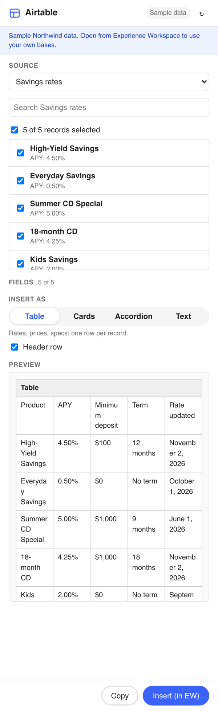
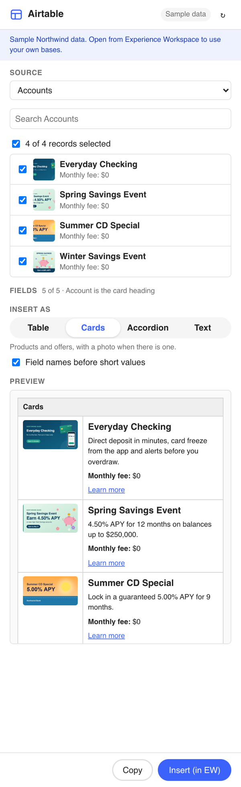
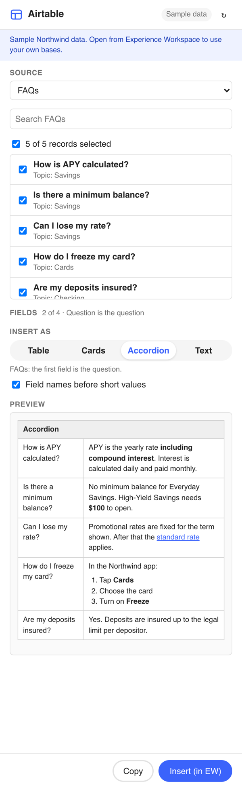
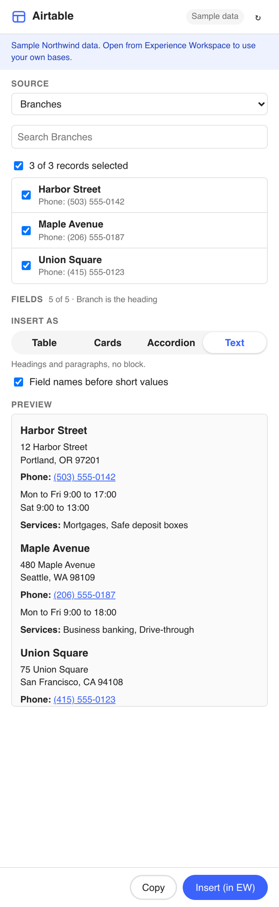
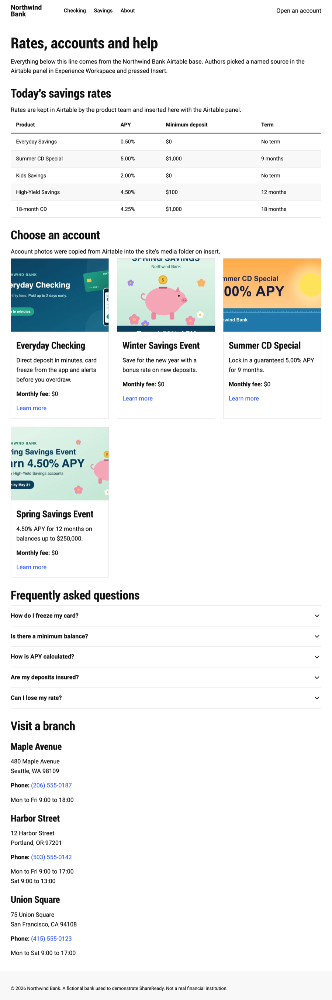
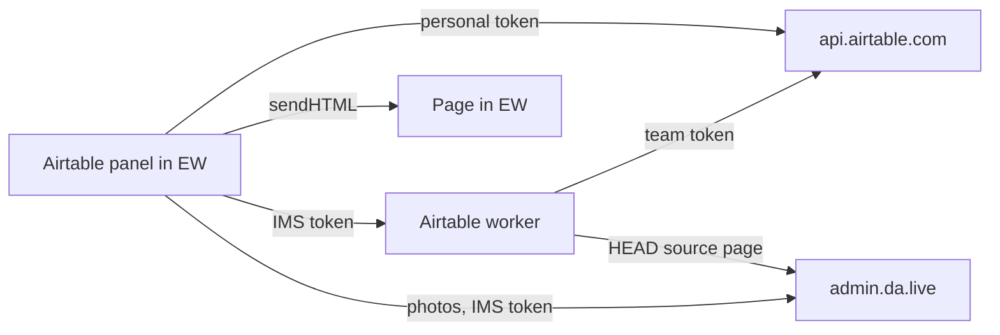

# Airtable for Experience Workspace

**Insert records from any Airtable base into a page as a table, cards, an accordion or plain text, with the photos copied into the site, from a panel next to the page.**

Teams already keep rates, products, store locations, events, team bios and FAQs in Airtable. Getting them onto a page usually means copying cell by cell, re-typing currency and dates, and downloading and uploading every photo. This Experience Workspace (EW) extension for AEM Edge Delivery Services does it in a few clicks. An author opens **Extensions › Airtable**, picks a source (for example *Savings rates*), ticks the records and fields they want, chooses how to show them and presses **Insert**. The content lands at the cursor as a normal block that the author can edit like anything else on the page.

<table>
  <tr>
    <td width="25%"></td>
    <td width="25%"></td>
    <td width="25%"></td>
    <td width="25%"></td>
  </tr>
  <tr>
    <td align="center"><b>Table</b>: rates, prices, specs</td>
    <td align="center"><b>Cards</b>: products with photos</td>
    <td align="center"><b>Accordion</b>: FAQs</td>
    <td align="center"><b>Text</b>: headings and paragraphs</td>
  </tr>
</table>



- **Try it now, no setup:** [panel demo with sample data](https://main--ew-shareready--vipult2022.aem.page/tools/airtable.html?demo=1)
- **Third party:** Airtable (Web API, read only)
- **Cost:** free. The Airtable Free plan is enough; the optional worker fits the Cloudflare Workers free tier.

## Contents

- [What it does](#what-it-does)
- [Try it](#try-it)
- [Install](#install)
- [Connect Airtable](#connect-airtable)
- [Configuration](#configuration)
- [Blocks](#blocks)
- [Security](#security)
- [How it works](#how-it-works)
- [Limits](#limits)
- [Troubleshooting](#troubleshooting)
- [Development](#development)
- [Marketplace listing](#marketplace-listing)

## What it does

1. **Pick a source.** Admins can name the tables authors use (*Savings rates*, *Accounts*, *FAQs*) so nobody needs to know base or table ids. Authors can also browse every base and table the connection can read, and choose an Airtable view to get its filter and sort order.
2. **Pick records.** All records are ticked to start. Search, untick or tick them one by one. Each row shows the photo, the title and one more value.
3. **Pick fields.** Sensible fields are ticked for each format, for example the question and answer for an accordion. Untick fields or move them up. The first field is the heading of each card, accordion item or text section.
4. **Pick a format.** The panel suggests one from the table: Cards when it has photos, Accordion for FAQs, otherwise Table.

   | Format | Inserts | Good for |
   | --- | --- | --- |
   | Table | a `Table` block with a header row (or `Table (no header)`) | rates, prices, specs, opening hours |
   | Cards | a `Cards` block: photo, heading, details and a *Learn more* link | products, offers, people, events |
   | Accordion | an `Accordion` block: question and answer | FAQs, terms |
   | Text | headings and paragraphs, no block | locations, short lists, anything to edit freely |

5. **Preview and insert.** The preview shows exactly what will be inserted. **Insert** copies the photos into the site and puts the content at the cursor. **Copy** puts it on the clipboard instead, to paste anywhere.

Values arrive the way Airtable shows them: currency (`$1,000`), percentages, dates in the site's locale, select options, linked record names. Rich text keeps its bold, italics, links and lists. URLs become links, emails become `mailto:` links and phone numbers become `tel:` links. With **Field names before short values** on, cards and text read *Monthly fee: $0*.

### Photos are copied into the site

Airtable's attachment links expire after a few hours, so a page must never point at them. Before inserting, the panel downloads each photo and saves it to the site's Document Authoring media folder (`/media/airtable/` by default) with your own sign-in. The page then uses those copies, which Edge Delivery Services optimises like any other image. Names include a short hash of the image, so inserting the same photo again reuses the copy. If a photo cannot be copied, nothing is inserted and the panel says so.

## Try it

The [demo](https://main--ew-shareready--vipult2022.aem.page/tools/airtable.html?demo=1) uses a sample Northwind Bank base (a fictional brand). It needs no EW, Airtable account or worker, and nothing is sent anywhere.

| Step | What to do |
| --- | --- |
| 1 | **Source › Savings rates** shows a rates table. Untick *Kids Savings*, or untick **Header row**. |
| 2 | **Source › Accounts** suggests **Cards** with each account's photo. Open **Fields** and untick *Monthly fee*. |
| 3 | **Source › FAQs** shows an **Accordion**. Search for `card` to find one question. |
| 4 | **Source › Branches** as **Text**: phone numbers become links. |
| 5 | **Copy**, then paste into any rich text editor. **Insert** works inside EW. |

The live demo site uses a real Airtable base with the same tables:

- Page: https://main--ew-shareready--vipult2022.aem.page/airtable-demo
- Edit (needs access to the `vipult2022` org): https://da.live/canvas#/vipult2022/ew-shareready/airtable-demo

## Install

You need:

- an Edge Delivery Services site authored in Document Authoring (da.live) with Experience Workspace, and permission to edit the site config,
- an Airtable account (the Free plan works),
- for the `Table` and `Accordion` formats, those blocks in your site ([Blocks](#blocks)). `Cards` is in the AEM boilerplate already, and `Text` needs no block.

Setup takes about 5 minutes.

### Option A: use the hosted copy

Open your site config at `https://da.live/config#/{org}/{site}/` and add this row to the **`library`** sheet. If the sheet doesn't exist yet, add it with the **+** button next to the sheet tabs.

| title | path | icon | experience |
| --- | --- | --- | --- |
| Airtable | `https://main--ew-shareready--vipult2022.aem.page/tools/airtable.html` | `https://main--ew-shareready--vipult2022.aem.page/tools/airtable/icon.svg` | `inline` |

Save the config and reload EW. Open a page, then **Extensions › Airtable**. Optionally add named sources and settings ([Configuration](#configuration)).

The hosted copy runs in your browser. It talks only to Airtable (with the token you give it, or through your own worker) and to Adobe's APIs with your own sign-in.

### Option B: host your own copy

To pin a version or change the code, copy these into your own site's repository:

```text
tools/airtable.html
tools/airtable/
blocks/table/       (optional, see Blocks)
blocks/accordion/   (optional, see Blocks)
```

Then use your own site's URLs in the `library` row (for example `https://main--{site}--{org}.aem.live/tools/airtable.html`). The files are plain JavaScript, HTML and CSS with no build step and no dependencies. Add `tools/airtable/test/*`, `tools/airtable/worker/*`, `tools/airtable/docs/*` and `tools/airtable/demo/*.mjs` to `.hlxignore` so they aren't served.

## Connect Airtable

There are two ways. Pick one per site.

### Each author uses their own token (no server)

The first time an author opens the panel, it asks for an Airtable personal access token:

1. Open [airtable.com/create/tokens](https://airtable.com/create/tokens) and choose **Create token**.
2. Add the scopes `data.records:read` and `schema.bases:read`. The panel never writes to Airtable, so give it nothing more.
3. Under **Access**, add the bases the author should be able to use.
4. Copy the token and paste it into the panel.

The token is kept in that browser's local storage and sent only to `api.airtable.com`. **Sign out** in the panel forgets it.

### The whole team shares one token (worker)

If authors don't have Airtable accounts, or you want one place to control which bases are used, deploy the small Cloudflare worker in [`worker/`](worker). It holds a team token, and only lets people who can read the page in Document Authoring use it. Authors then never see a token prompt.

1. **Get the code and sign in to Cloudflare** (the free plan is enough):

   ```sh
   git clone https://github.com/vipult2022/ew-shareready.git
   cd ew-shareready/tools/airtable/worker
   npx wrangler login
   ```

2. **Edit `wrangler.toml`.** Set `ALLOWED_ORGS` to your org (`my-org`) or site (`my-org/my-site`). Optionally set `AIRTABLE_BASES` to the base ids the worker may read.
3. **Add the token and deploy.** Create a token as above (read scopes, your bases under Access), then:

   ```sh
   npx wrangler secret put AIRTABLE_TOKEN
   npx wrangler deploy
   curl https://airtable.<your-subdomain>.workers.dev/status
   # {"ok":true,"service":"airtable","configured":true,"limitedBases":false}
   ```

4. **Connect it to your site.** Add `worker-url` to the `airtable` sheet ([Configuration](#configuration)). The panel header then shows **Team connection**.

## Configuration

Both sheets are optional and live in the site config at `https://da.live/config#/{org}/{site}/`.

### `airtable` sheet (settings)

| key | value | default |
| --- | --- | --- |
| `worker-url` | Your worker, e.g. `https://airtable.my-team.workers.dev`. Leave it out to use personal tokens. | |
| `locale` | How Airtable formats numbers and dates, e.g. `en-gb`, `de-de`. | `en-us` |
| `time-zone` | For dates with times, e.g. `Europe/London`. | the author's time zone |
| `link-text` | The text of URL links in cards. | `Learn more` |
| `image-folder` | Where copied photos go in Document Authoring. | `/media/airtable` |
| `max-records` | The most records read at once (up to 300). Use an Airtable view to narrow bigger tables. | `300` |
| `allow-browse` | `no` limits authors to the named sources below. | `yes` |

Any setting can also go in the panel URL for testing, for example `tools/airtable.html?locale=en-gb`.

### `airtable-sources` sheet (named sources)

Each row is a source authors can pick by name.

| column | value |
| --- | --- |
| `title` | What authors see, e.g. `Savings rates`. Required. |
| `base` | The base id, `app…` (from the base's URL). Required. |
| `table` | The table name or id (`tbl…`). Required. |
| `view` | Optional view name or id (`viw…`), for its filter and sort. |
| `fields` | Optional comma-separated field names, in order, e.g. `Question, Answer`. |
| `format` | Optional `table`, `cards`, `accordion` or `text`. |
| `block` | Optional block name instead of the format's default, e.g. `Cards (featured)`. |
| `labels` | Optional `no` to leave field names out of cards, accordions and text. |
| `header` | Optional `no` for tables without a header row. |

The demo site uses:

| title | base | table | fields | format |
| --- | --- | --- | --- | --- |
| Savings rates | `app5eAg9WToHjn2hs` | Savings rates | | table |
| Accounts | `app5eAg9WToHjn2hs` | Accounts | | cards |
| FAQs | `app5eAg9WToHjn2hs` | FAQs | Question, Answer | accordion |
| Branches | `app5eAg9WToHjn2hs` | Branches | | text |

To create the same demo tables in your own base, run `AIRTABLE_TOKEN=pat… node tools/airtable/demo/setup-northwind.mjs app…` with a token that also has the `schema.bases:write` and `data.records:write` scopes.

## Blocks

| Format | Block | Where to get it |
| --- | --- | --- |
| Table | `table` | [`blocks/table`](../../blocks/table) in this repo, or the [Block Collection](https://www.aem.live/developer/block-collection/table) |
| Cards | `cards` | the [AEM boilerplate](https://github.com/adobe/aem-boilerplate/tree/main/blocks/cards) |
| Accordion | `accordion` | [`blocks/accordion`](../../blocks/accordion) in this repo, or the [Block Collection](https://www.aem.live/developer/block-collection/accordion) |
| Text | none | |

The inserted content follows the usual block structure (first row is the block name, then one row per record), so any block with the same name and structure works, including your own. Use the `block` column to insert a variant, such as `Cards (featured)`.

## Security

- **Read only.** The panel and the worker only read from Airtable. Use tokens with read scopes only.
- **Personal tokens** stay in the author's browser and go only to `api.airtable.com`.
- **The team token** stays in the worker. Every request must carry the author's Adobe IMS token, and the worker checks that this token can read the current page through the Document Authoring source API (cached for five minutes). Requests for orgs or sites not in `ALLOWED_ORGS`, from origins not in `ALLOWED_ORIGINS`, or for bases outside `AIRTABLE_BASES` are refused. Each token is limited to 60 requests a minute.
- **No markup injection.** Every Airtable value is escaped. Only `https:`, `mailto:` and `tel:` links are kept. The panel shows record text as text.
- **Photos** are written to Document Authoring with the author's own sign-in, so they can only go where the author can already write.

## How it works



1. The panel loads the Document Authoring SDK to get the site, the page and the author's sign-in, then reads the `airtable` and `airtable-sources` sheets from the site config.
2. It reads bases, tables (with field types) and records with `cellFormat=string`, so every value is Airtable's display text. Results are cached for a minute; **↻** reloads them.
3. The field type decides how each value becomes HTML ([`lib/format.js`](lib/format.js)).
4. On **Insert**, photos are copied into `/media/airtable/` and the HTML is inserted at the cursor with the SDK's `sendHTML`.

### Files

| File | What it does |
| --- | --- |
| `../airtable.html`, `airtable.js`, `panel.js`, `airtable.css` | The panel |
| `lib/airtable.js` | Airtable Web API client, shared by the panel and the worker |
| `lib/connection.js` | Personal token, team worker and sample-data connections |
| `lib/format.js` | Records to Table, Cards, Accordion or Text HTML, rich text Markdown |
| `lib/fields.js` | Field order, defaults per format, search |
| `lib/images.js` | Copies photos into Document Authoring |
| `lib/config.js` | Reads the config sheets |
| `worker/` | Optional Cloudflare worker for a shared team token |
| `demo/` | Sample data and the script that creates the demo base |
| `test/` | Tests |

### Worker API

| Route | Body | Returns |
| --- | --- | --- |
| `GET /status` | | `{ ok, service, configured, limitedBases }` |
| `POST /bases` | `{ org, site, path }` | `{ bases: [{ id, name }] }` |
| `POST /tables` | `{ org, site, path, base }` | `{ tables: [{ id, name, primaryFieldId, fields, views }] }` |
| `POST /records` | `{ org, site, path, base, table, view?, locale?, timeZone?, max? }` | `{ records: [{ id, fields }], more }` |

Every `POST` needs `Authorization: Bearer {IMS token}`.

## Limits

- **Airtable Free plan:** 1,000 API calls a month per workspace and 5 requests a second per base. Opening a source takes two or three calls; the panel caches for a minute. Paid plans have higher limits.
- **Up to 300 records** per source. Use an Airtable view to filter bigger tables.
- **A snapshot, not a sync.** Inserted content is ordinary page content. If Airtable changes, insert again. This keeps the page fast and lets authors edit the copy.
- **Insert goes at the cursor.** EW can't replace a block in place, so the panel won't insert a block inside another block. Click an empty line first; to update a block, delete it and insert again.
- **Attachments that aren't images** become links to Airtable, which expire. Host files like PDFs in the site instead.
- **Field types:** buttons, created/modified by and auto numbers are left out by default. Lookups and formulas come through as their text.

## Troubleshooting

| Message | What to do |
| --- | --- |
| *Airtable did not accept the token* | The token was revoked, expired or mistyped. Create a new one. |
| *The token cannot read this base* | Open the token in Airtable and add the base under **Access**. |
| *Airtable could not find that base, table or view* | Check the names in `airtable-sources`; a table or view may have been renamed. |
| *used its API calls for the month* | The workspace hit the Free plan limit. Wait for next month or upgrade. |
| *Your cursor is inside a block* | Click an empty line outside the block, then **Insert**. |
| *could not be copied into the site* | Check you can edit the site in Document Authoring, then try again. |
| *Could not reach the Airtable worker* | Check `worker-url` and `curl {worker-url}/status`. |
| *This worker does not serve …* | Add the org or site to `ALLOWED_ORGS` and redeploy. |
| Blocks show as plain tables on the page | Add the `table` or `accordion` block to your site ([Blocks](#blocks)). |

## Development

```sh
npm install
node --test tools/airtable/test/   # format, config, connection and worker tests
npx eslint tools/airtable blocks   # ESLint (airbnb)
npx -y @adobe/aem-cli up           # serves the repo on localhost:3000
```

- **Locally:** open http://localhost:3000/tools/airtable.html?demo=1.
- **Inside EW:** add `?ref=local` to the EW URL to load the extension from `localhost:3000`.
- **Run the worker locally:** `cd tools/airtable/worker && npx wrangler dev` (put `AIRTABLE_TOKEN` in `.dev.vars`), then add `?worker-url=http://localhost:8787` to the panel URL.

## Marketplace listing

| Field | Value |
| --- | --- |
| Title | Airtable |
| Description | Insert records from any Airtable base into a page as a table, cards, an accordion or text, with photos copied into the site. Works with each author's own read-only token, or a shared team connection. |
| Type | Plugin |
| Category | Extension |
| Status | Early Access |
| Owner | vipult2022 |
| Doc Url | https://github.com/vipult2022/ew-shareready/tree/main/tools/airtable#readme |
| Try Url | https://main--ew-shareready--vipult2022.aem.page/tools/airtable.html?demo=1 |
| Image | https://main--ew-shareready--vipult2022.aem.page/tools/airtable/marketplace.png (1200×896) |
| Logo | https://main--ew-shareready--vipult2022.aem.page/tools/airtable/icon.svg |


The Marketplace image is drawn in HTML and CSS. Its source is in [`docs/marketplace.html`](docs/marketplace.html).

## License

[Apache License 2.0](../../LICENSE). Airtable is a trademark of Formagrid, Inc.; this extension is not made or endorsed by Airtable. Northwind Bank is a fictional brand used for the demo content.
