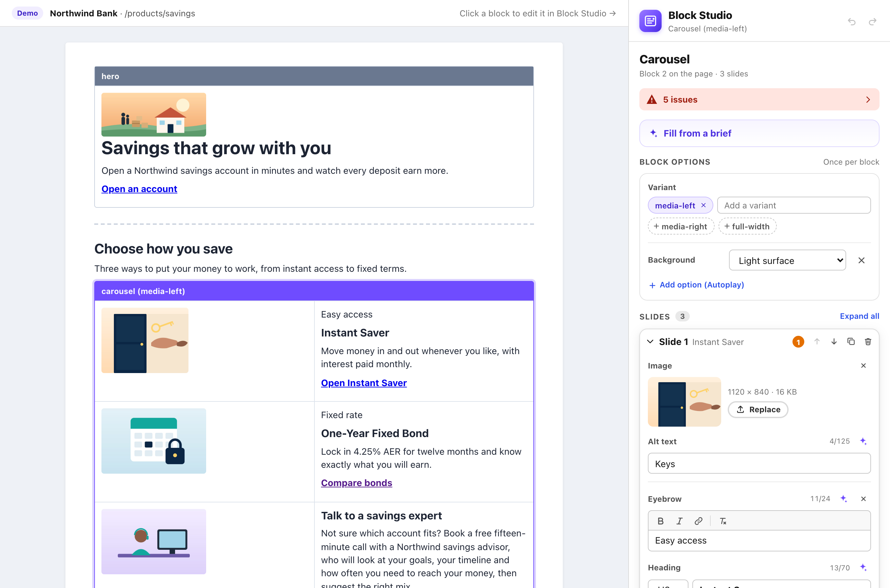
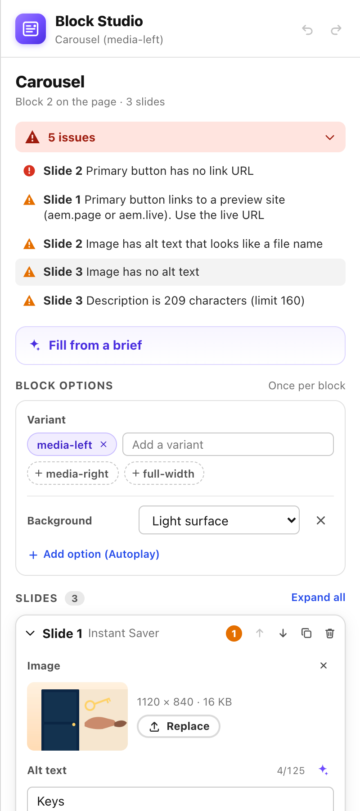
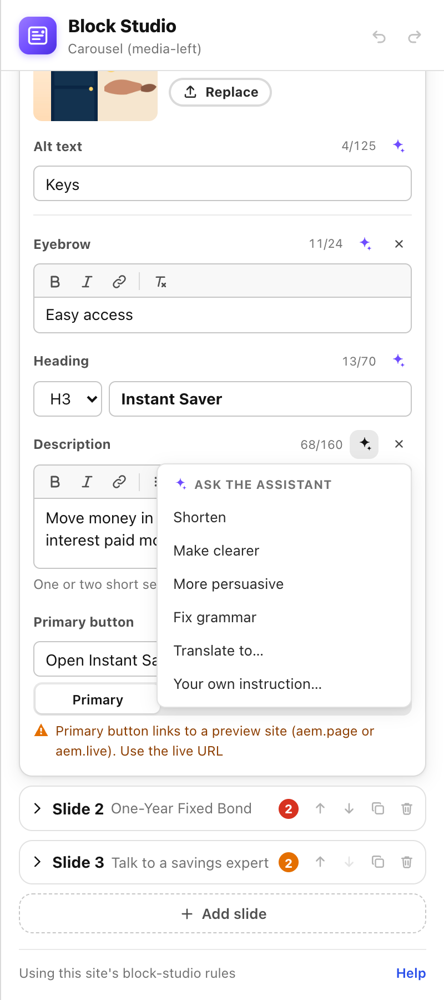
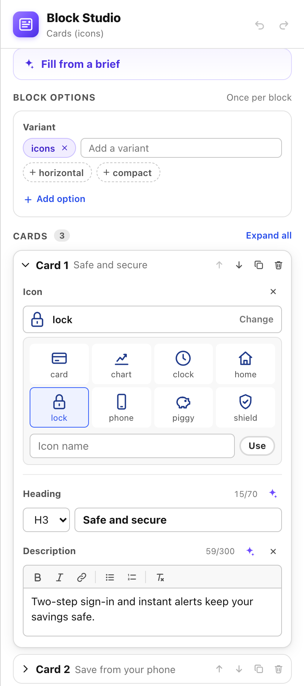
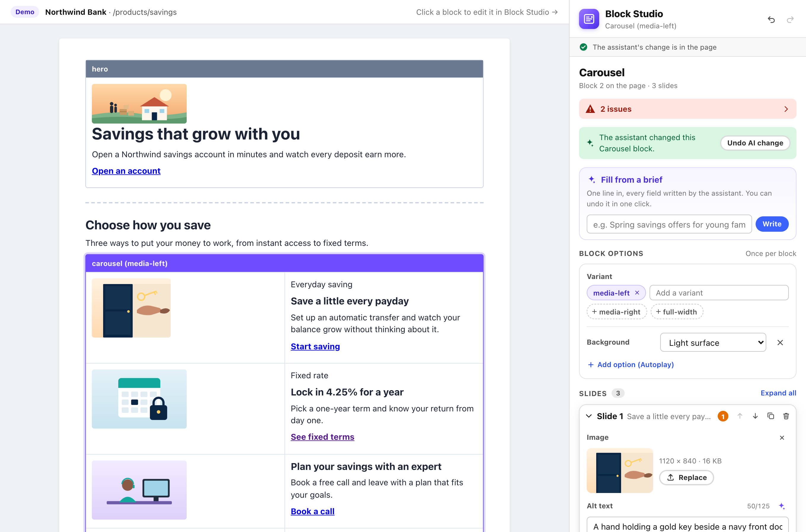
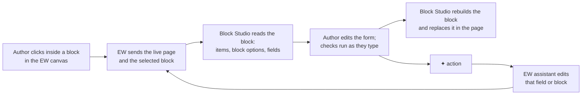
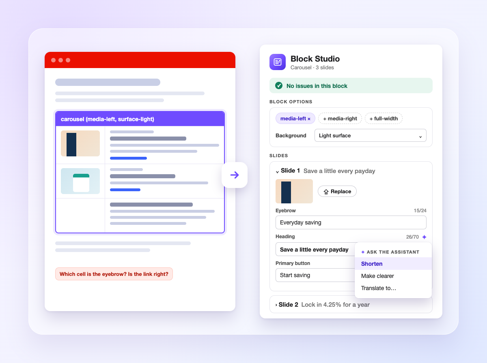

# Block Studio for Experience Workspace

**Edit any block as a simple form. Click inside a block in Experience Workspace and Block Studio turns its table into labelled fields: headings, rich text, images with alt text, buttons, icons, variants and block options. It checks each field as you type, writes the block back into the page as you pause, and has the EW assistant shorten, rewrite, translate or fill the whole block from a one-line brief. There's no setup: one `library` row and it works on every block of every site.**

In Experience Workspace (EW), a block is a table. Authors have to remember which cell is the eyebrow and which is the description, what goes in a `theme | surface-light` row, which variant names exist, and whether the button link is right. A card with a missing cell breaks the layout, settings rows show up as items, and nothing tells the author the heading is too long or the image has no alt text. Block Inspector, Adobe's block form editor, helps, but every block and variant needs fields written by hand first.

Block Studio reads the block itself instead:

- **Zero-config forms.** It detects each field (heading, rich text, image and alt, button, icon, list) and labels it, with no setup per block.
- **Items and block options.** Repeating rows (slides, cards, tabs) become items you can add, duplicate, move and delete. Settings rows such as `theme | surface-light` become **Block options**, edited once per block, with dropdowns of the values the site allows.
- **Checks as you type.** Character limits, missing alt text, buttons with no link, links to preview sites or `localhost`, image size. Clicking an issue jumps to its field.
- **The EW assistant on every field.** Shorten, Make clearer, More persuasive, Fix grammar, Translate, your own instruction, Suggest alt text, and **Fill from a brief** for the whole block. **Undo AI change** puts it back in one click.



<table>
  <tr>
    <td width="25%"></td>
    <td width="25%"></td>
    <td width="25%"></td>
    <td width="25%"></td>
  </tr>
  <tr>
    <td align="center"><b>Checks</b>: click one to jump to it</td>
    <td align="center"><b>Assistant</b>: on every field</td>
    <td align="center"><b>Icons</b>: from the site</td>
    <td align="center"><b>Brief</b>: the whole block, undoable</td>
  </tr>
</table>

- **Try it now, no setup:** [Block Studio demo with a sample page](https://main--ew-shareready--vipult2022.aem.page/tools/blockstudio.html?demo=1)
- **Third party:** GitHub: the icon picker lists the site's `/icons` folder through GitHub's public REST API. The AI actions use the EW assistant, so there are no keys to manage.
- **Cost:** free. No worker, no secrets, no paid service.

## Contents

- [What it does](#what-it-does)
- [Try it](#try-it)
- [Install](#install)
- [Configuration](#configuration)
- [How blocks are read](#how-blocks-are-read)
- [Security](#security)
- [How it works](#how-it-works)
- [Limits](#limits)
- [Troubleshooting](#troubleshooting)
- [Development](#development)
- [Marketplace listing](#marketplace-listing)
- [Credits](#credits)
- [License](#license)

## What it does

Open a page in EW, then **Extensions › Block Studio**, and click inside any block. The panel follows the cursor: click another block and it shows that one.

**The form**

| Part | What the author sees |
| --- | --- |
| Header | The block's name and variants, with **Undo** and **Redo** for everything done in the panel. In a rich text field, Cmd/Ctrl+Z and Shift+Cmd/Ctrl+Z do the same. |
| Block health | "No issues" or "3 issues". Open it to see each issue; click one to jump to its field. Items with issues show a red or amber count. |
| Fill from a brief | One line in ("Spring savings offers for young families"), and the assistant writes every field of the block. |
| Block options | A **Variant** dropdown: Default plus the block's documented variants (from the block library or the rules sheet), with the chosen one's description. Authors can't type their own. Then the block's **options**: each option the library's `options` sheet defines for the block is always shown as a dropdown, text field, switch or image picker, with its default. Other setting rows (`theme`, `autoplay`, …) show as a dropdown with friendly labels, or a text field, and **+ Add option** lists the known settings this block doesn't have yet. |
| Item fields | Each field is named from the block library: the `fields` table in an example's `library-metadata` ("Question", "Answer") or the library's `fields` sheet ("Card title", "Card background"), which also adds limits, required flags and slots for any declared field an item is missing. |
| Items | Slides, cards, tabs or accordion rows as collapsible items, named from the block ("Slide 1", "Card 2") with their heading as a subtitle. Add, duplicate, move up or down, delete (with Undo). New items go in before the settings rows, which never move. |
| Groups | Blocks whose rows differ (hero, columns) are shown row by row as fixed groups instead of items. |

**Fields**

| Field | Editing |
| --- | --- |
| Heading | Text with an **H1–H6** picker. |
| Rich text | A toolbar like DA's: **Paragraph** or **Heading 2–6**, Bold, Italic, Underline, Strikethrough, Link, Code, Superscript, Subscript, bulleted and numbered lists, Quote and Clear formatting. A description can hold its own subheadings ("Who it's for", then a paragraph); they stay in that field. Short fields (an eyebrow with a 24-character limit) get a single-line editor with inline tools only. Text pasted from Word or Google Docs is cleaned. |
| Image | Thumbnail, pixel size and file size, **Replace** (PNG, JPEG, GIF, WebP or SVG, up to 20 MB) and an **Alt text** field. |
| Button | Text, URL and style: **Primary**, **Secondary** or **Plain link** (and **Accent** when the page already uses it). |
| Icon | `:lock:` tokens show as an icon with a picker of the site's icons, or type any icon name. |
| Missing field | An item with a missing cell (a card with no button) shows "+ Add button", so mixed layouts work. |

Every text field has a **character counter** that turns amber near the limit and red over it, and a **✦** menu for the assistant:

| On | Actions |
| --- | --- |
| Text | Shorten, Make clearer, More persuasive, Fix grammar, Translate to… (9 languages), Your own instruction… |
| Image | Suggest alt text |
| Whole block | Fill from a brief |

The assistant edits the page itself, so the change is visible straight away. The panel then shows **The assistant changed this block** with **Undo AI change**.

**Checks**

| Check | Level |
| --- | --- |
| Empty heading, button with no text or no link URL, image with no picture | Error |
| Required field or setting empty or missing (from the rules sheet) | Error |
| Over the character limit (Heading 70, Text 300, Button 25, Alt 125, or the rules sheet's `max`) | Warning |
| Image without alt text, or alt text that looks like a file name (`IMG_2041.jpg`) | Warning |
| Link to `localhost`, to a preview site (`*.aem.page`, `*.aem.live`), over `http://`, or with a link type that isn't allowed | Warning |
| Image file over 5 MB, or under 400 px wide | Warning |
| Setting with no value, or a value that isn't in its list | Warning |
| Icon not picked, or not one of the site's icons (when the rules sheet lists them) | Warning |
| Empty item | Warning |

**Saving**

- Changes are written into the page about 0.8 seconds after you stop typing, or when you leave a field. The status line says **Saved to page**.
- If you click outside the block while changes are waiting, the panel says **Click the Carousel block in the page to save your changes**, with **Discard**. Nothing is lost.
- If someone else changes the block while you edit, the panel reloads it and offers **Re-apply my changes** or **Discard mine**.
- If you can't edit the page (read-only access), the form is shown read-only.

## Try it

The [demo](https://main--ew-shareready--vipult2022.aem.page/tools/blockstudio.html?demo=1) runs the real panel against a sample Northwind Bank savings page, with a pretend assistant. Nothing is saved.

| Step | Do | See |
| --- | --- | --- |
| 1 | Look at the carousel, which is selected | The form, with **5 issues** |
| 2 | Open **5 issues** and click *Slide 3 Image has no alt text* | Slide 3 opens with the cursor in its alt text |
| 3 | Type a heading that's too long | The counter turns red, the issue appears, and the page updates as you pause |
| 4 | Click **✦** next to a description, then **Shorten** | The description is shortened in the page, with **Undo AI change** |
| 5 | Open **Fill from a brief**, type "Savings for first-time savers", **Write** | Every slide rewritten |
| 6 | Change **Background** to *Dark surface*, or click **+ media-right** | The block's settings row and class change in the page |
| 7 | **Duplicate** Slide 1, then **Delete** it, then **Undo** | Items are added and removed; settings rows stay at the end |
| 8 | Click the cards block in the page and open a card's icon | The icon picker |

## Install

You need an Edge Delivery Services site authored in Document Authoring (da.live) with Experience Workspace, and permission to edit the site config. Setup takes about two minutes.

### Option A: use the hosted panel

Open your site config at `https://da.live/config#/{org}/{site}/` and add this row to the **`library`** sheet. If the sheet doesn't exist yet, add it with the **+** button next to the sheet tabs.

| title | path | icon |
| --- | --- | --- |
| Block Studio | `https://main--ew-shareready--vipult2022.aem.page/tools/blockstudio.html` | `https://main--ew-shareready--vipult2022.aem.page/tools/blockstudio/icon.svg` |

Save the config and reload EW. Open a page, then **Extensions › Block Studio**, and click inside a block.

That's all: the [rules sheet](#configuration) is optional. The hosted panel runs in your browser and talks only to Adobe's APIs with your own sign-in, and to GitHub's public API for the icon list.

### Option B: host your own copy

To pin a version or change the code, copy these into your own site's repository:

```text
tools/blockstudio.html
tools/blockstudio/
```

Then use your own site's URLs in the `library` row (for example `https://main--{site}--{org}.aem.live/tools/blockstudio.html`). The files are plain JavaScript, HTML and CSS with no build step and no dependencies, and the folder needs nothing from the rest of this repo. Add `tools/blockstudio/test/*` and `tools/blockstudio/docs/*` to `.hlxignore` so they aren't served.

## Configuration

Everything is optional. With no configuration, Block Studio uses the default labels and limits, the icons found on the page, and the site's `/icons` folder. Variants need the block library or the rules sheet: authors only choose documented variants.

### The `block-studio` sheet

Add a sheet named **`block-studio`** to the site config (`https://da.live/config#/{org}/{site}/`), or to the org config to share it across sites. Site rows are read after org rows, and a block's own rows override its `*` rows.

| Column | Meaning |
| --- | --- |
| `block` | Block name (`carousel`, `cards`), or `*` for every block |
| `field` | Field label, as a slug (`heading`, `eyebrow`, `primary-button`, `description`), or a field type (`heading`, `text`, `button`, `image`), or a setting key (`theme`), or one of the special fields below |
| `label` | Label shown in the panel |
| `max` | Character limit |
| `required` | `yes` to report an empty field as an error |
| `hint` | Help text shown under the field |
| `values` | For a setting: the allowed values, as `Label=value\|Label 2=value-2`, or a comma list |

Special fields:

| `field` | `values` | Does |
| --- | --- | --- |
| `variants` | `media-left, media-right, full-width` | Variants added to the Variant dropdown |
| `options` | `theme, autoplay` | Rows with these keys are always block options |
| `items` | `faq, step`, or `all` | Rows with these keys are always items. `all` turns detection of options off. The `label` column names the items ("Slide") |
| `icons` | `lock, piggy, phone` | Icons offered in the picker, in addition to the site's |

Example, as used by the demo:

| block | field | label | max | required | hint | values |
| --- | --- | --- | --- | --- | --- | --- |
| carousel | theme | Background | | yes | The colour behind the slides. | `No background=none\|Light surface=surface-light\|Brand tint=surface-tint\|Dark surface=surface-dark` |
| carousel | autoplay | Autoplay | | | | `Off=off\|Every 5 seconds=5s\|Every 8 seconds=8s` |
| carousel | variants | | | | | `media-left, media-right, full-width` |
| carousel | items | Slide | | | | |
| carousel | description | | 160 | | One or two short sentences. | |
| carousel | eyebrow | | 24 | | | |
| cards | icons | | | | | `lock, piggy, phone, shield, chart, home, card, clock` |
| * | heading | | 70 | | | |

### Configure a block from the block library

Block Studio has no per-block code. A new block is configured in the site's **block library** (the **Blocks** row of the `library` sheet; see [Set up the library](https://www.aem.live/docs/ew/administering/set-up-library)), so the same panel works on any project. The library can be published pages (`/library/blocks.json`) or kept in DA (`https://content.da.live/{org}/{site}/library/blocks.json`); DA-hosted files are read with your EW sign-in.

A block gets four kinds of configuration:

| What | Where | Panel shows |
| --- | --- | --- |
| **Variants**: fixed looks, written as classes (`cards horizontal`) | The block's example page in the library | A dropdown of the documented looks, with the chosen one's description |
| **Block options**: settings for the whole block (`theme`, `background`) | The library's `options` sheet | One typed control per option |
| **Field names**: what each field in an example is | A `fields` table in the example's `library-metadata`, plus `multi` in the `editor` sheet for repeating blocks | "Question" and "Answer" instead of "Title" and "Description" |
| **Item fields**: the cells of each card, slide or tab | The library's `fields` sheet | Named fields, limits, required checks and "Add …" slots |

**Variants.** Each example on a block's library page whose class has variants is one choice in the **Variant** dropdown, with all its classes together: `cards horizontal` adds Horizontal and `cards icons compact` adds "Icons, Compact". The same classes in another order are the same choice, and an example without variants is the Default. The example's `library-metadata` description is shown under the dropdown when it's chosen. Each value in the rules sheet's `variants` field adds a single-class choice. Authors can only choose from this list; there's no free-text variant. A variant already on the page that isn't documented is shown as "(undocumented)" with a warning, so the author can pick a documented one or Default.

**Field names.** Block Studio names fields automatically (see [How blocks are read](#how-blocks-are-read)), so an accordion's question and answer show as **Title** and **Description**. To give them real names, add a `fields` row to the `library-metadata` block under the example on the block's library page. Its value is a table in [Block Inspector](https://github.com/adobe-rnd/ew-extensions)'s format, so a library set up for Block Inspector already works:

- The first row is a single **Fields** cell.
- For a block of repeating items (cards, accordion, carousel), mark it `multi` in the library's `editor` sheet (below) and add **one** row of labels for the first item. It names every item, so adding a card or an FAQ never needs a library change.
- For any other block (hero, columns), one row of labels per row of the example, with the same number of cells, since each row is a different thing.
- In each cell, one paragraph per field, in order: a heading, a picture, a list, a button or a paragraph of text is one field each. Block Studio edits consecutive paragraphs as one rich text field, which takes their labels together ("Intro & Details").
- `IGNORE` (or an empty paragraph) keeps the automatic name. In a row-per-row table, label option rows (`theme | dark`) `IGNORE`.

For an accordion:

| library-metadata | |
| --- | --- |
| description | Questions that open to show their answer. |
| fields | (a table:) **Fields**, then one row: **Question** \| **Answer** |

The library's `editor` sheet (Block Inspector's, in the same `blocks.json` as `blocks`) lists the repeating blocks:

| block | property |
| --- | --- |
| accordion | multi |
| cards | multi |

Without it, Block Studio still treats one label row as naming every item, and in a block of items the first item's labels also name items beyond the example. Each variant's example can name its fields; a block with no example for its variant uses the default example's names. When labels don't line up with the example's content, that cell keeps its automatic names. The `fields` sheet below wins for any column it describes.

**Name this block's fields (from the panel).** A new block doesn't have to be named by hand. When the open block has no names yet (no `fields` table and no `fields` sheet rows), and you can write to the block library in DA, the panel shows **Name this block's fields**. Open it and Block Studio suggests a name for every field, one row per item for a repeating block or one row per row for a hero or columns:

- Names come from the rules sheet's `label` first, then the item's noun ("Slide image", "Slide title"), taken from the rules sheet's `noun`, the block's code (`blocks/carousel/carousel.js` says "slide") or the block's name.
- Edit any name, then **Save names**. Under the names, **Saving will** lists each change first.

Saving writes, in DA:

| Change | When |
| --- | --- |
| A `fields` table in the example's `library-metadata` | Always. An existing `library-metadata` keeps its other rows. |
| The block's library page, with this block as its example | The block has no library page, or its page has no example of it |
| A row in the library's `blocks` sheet | The block isn't listed yet |
| A `multi` row in the `editor` sheet | The block repeats items |

The panel uses the new names straight away. EW's own library list picks up a new block after the library is previewed, or on the next reload. The card doesn't show in read-only access, on blocks that only hold options, or when the library isn't in DA.

**Block options.** The library's `options` sheet uses Block Inspector's columns (`blocks | key | values`), so an existing setup keeps working. Block Studio reads three more columns, which EW ignores:

| Column | Meaning |
| --- | --- |
| `blocks` | Block name, a comma list, or `all` |
| `key` | The option's key, written as the first cell of its row (`theme`) |
| `values` | For a `select`: `Label=value\|Label 2=value-2` |
| `label` | Label shown in the panel |
| `type` | `select` (the default when there are values), `text`, `toggle` (writes `true`, removed when off) or `image` (one picture) |
| `default` | The value the block uses when the row is absent. Choosing it removes the row |

| blocks | key | values | label | type | default |
| --- | --- | --- | --- | --- | --- |
| cards | theme | `Light=light\|Dark=dark` | Theme | select | light |
| cards | background | | Block background | image | |

**Item fields.** Add a sheet named **`fields`** to the library's `blocks.json`, after `blocks` and `options` (EW reads the first sheet as the block list, so `blocks` must stay first):

| Column | Meaning |
| --- | --- |
| `block` | Block name or a comma list |
| `column` | The cell, counting from 1 |
| `name` | A short id (`title`, `background`) |
| `type` | `image`, `text`, `heading`, `button` or `icon` |
| `label` | Name shown in the panel; also the name the rules sheet's `field` column matches |
| `required` | `yes` to report it missing or empty as an error |
| `max` | Character limit |
| `hint` | Help text |

| block | column | name | type | label | required | max | hint |
| --- | --- | --- | --- | --- | --- | --- | --- |
| cards | 1 | image | image | Card image | | | |
| cards | 2 | title | heading | Card title | | 60 | |
| cards | 2 | body | text | Card text | yes | 160 | One or two short sentences. |
| cards | 3 | background | image | Card background | | | Fills the card behind the text. |

The rules sheet still applies on top, and its rows win.

#### The block contract (site code)

Options are written into the block as plain two-cell rows (`theme | dark`, `background | <picture>`), the same rows EW's block inspector writes. A block that supports options must read and remove them in its `decorate`, so they never render as an extra card. This site's [`scripts/block-options.js`](../../scripts/block-options.js) does that for any block:

```js
import readBlockOptions from '../../scripts/block-options.js';

export default function decorate(block) {
  // Removes the rows; sets data-theme="dark"; returns the background picture.
  const { background } = readBlockOptions(block, ['theme', 'background']);
  // …decorate the remaining rows as items
}
```

Style the option with `.cards[data-theme='dark']`. When the row is absent, set the default yourself so both looks are explicit: the cards block sets `data-theme="light"` and its light rules keep the cards readable even inside a dark section. See [`blocks/cards/cards.js`](../../blocks/cards/cards.js) for a full example, including a third-column card background.

### Icons

The icon picker lists the SVG files in the `/icons` folder of the site's GitHub repository (`https://api.github.com/repos/{org}/{site}/contents/icons`), plus the icons already used on the page and the rules sheet's `icons`. Icons are shown from `https://main--{site}--{org}.aem.live/icons/{name}.svg`.

## How blocks are read

| Row | Becomes |
| --- | --- |
| Two short plain cells at the top or bottom of the block, with a lowercase key (`theme \| surface-light`) or a common setting word (`Style`, `Theme`, `Layout`) | A **block option** |
| A row whose key is in the rules sheet's `options` or in the library's `options` sheet, wherever it is | A **block option** |
| The other rows, when the block is a known repeater (cards, carousel, tabs, accordion, …) or the rows have the same cells and similar content | **Items** |
| Otherwise | **Groups**, one per row (hero, columns) |

Inside a cell, consecutive paragraphs and lists form one rich text field, `h1`–`h6` a heading, a picture an image, a link alone in its paragraph a button (`strong` = Primary, `em` = Secondary, both = Accent, neither = Plain link), and `:name:` an icon. Labels come from position and type: the short text before the heading is the **Eyebrow**, the first heading the **Heading** and the next a **Subheading**, the text after it the **Description**, a list the **List**, and a button is named by its style (**Primary button**, **Secondary button**, **Link**). Repeated labels are numbered (**Primary button 2**). In a block of items with no headings, a cell holding one short line in every item (an accordion's question) is the **Title**. Names from the block library replace these (see [Field names](#configure-a-block-from-the-block-library)), and the names shown are what the rules sheet's `field` column matches.

Block Studio writes back only what you changed. Unedited fields, rows and cells keep their exact original HTML.

## Security

- **No secrets and no server.** The panel is static files. It has no worker and no keys.
- **Your own sign-in.** Reading the config and uploading images use the IMS token EW gives the panel, sent only to `admin.da.live` and `content.da.live`, never to another host. The GitHub icon list is fetched without credentials.
- **Clean HTML only.** Every rich text value, typed or pasted, is rebuilt from paragraphs, lists, line breaks, links, bold, italic, underline, strikethrough, sub, sup and code. Every other tag and every attribute except a link's `href` and `title` is dropped, so scripts, styles, frames, forms and event handlers can't get in. Links are limited to `https:`, `http:`, `mailto:` and `tel:`.
- **The assistant edits only through EW.** Block Studio doesn't call an AI service. It asks the EW assistant, which uses the author's own permissions and EW's own safeguards.

## How it works



1. The panel uses EW's plugin SDK (`https://da.live/nx/utils/sdk.js`). It needs the `liveDocument` and `sendHTMLReplace` capabilities; the AI actions also need `chatTurnCompleted`.
2. `subscribeLiveDocument` sends the page HTML and the selected block each time either changes. The panel reads that block into a model (`lib/model.js`) and shows it as a form (`panel.js`).
3. Each edit is a small operation on the model. After a pause, the panel rebuilds the block's HTML (`buildBlock`) and calls `sendHTML(html, { replace: true })`, which swaps the selected block in the page. The next live update confirms it.
4. Undo and Redo replay the stored HTML of each save. If the live block no longer matches what the panel last wrote, someone else changed it, and the panel offers to re-apply.
5. An AI action sends a precise prompt with `setPrompt(prompt, { autoSend: true })`, naming the block by position and first words and the field by label and current text. When `chatTurnCompleted` fires, the panel reads the changed block from the live page and keeps the previous HTML for **Undo AI change**.
6. **Replace** uploads the image to `https://admin.da.live/source/{org}/{site}/{folder}/.{page}/{name}-{id}.{ext}`, next to the page, where DA keeps a page's images, and puts its `content.da.live` URL in the block.

### Files

| File | Does |
| --- | --- |
| `tools/blockstudio.html` | The panel page EW opens |
| `tools/blockstudio/blockstudio.js` | Controller: SDK, live page, saving, undo, uploads, AI |
| `tools/blockstudio/panel.js` | The form UI |
| `tools/blockstudio/blockstudio.css` | Styles (Spectrum-like, matching the other extensions) |
| `tools/blockstudio/lib/model.js` | Reads a block into items, options and fields; applies edits; writes it back |
| `tools/blockstudio/lib/live.js` | Finds blocks in the live page and strips EW's markup |
| `tools/blockstudio/lib/check.js` | Checks and character limits |
| `tools/blockstudio/lib/rules.js` | The `block-studio` sheet and the block library's `options` and `fields` sheets, variants and field names |
| `tools/blockstudio/lib/naming.js` | **Name this block's fields**: suggests names and writes them to the block library |
| `tools/blockstudio/lib/sanitize.js` | Cleans rich text and pasted HTML |
| `tools/blockstudio/lib/ai.js` | Prompts for the EW assistant |
| `tools/blockstudio/lib/dom.js` | Small DOM helpers |
| `tools/blockstudio/lib/demo.js`, `demo/` | Demo mode: sample page, pretend host and assistant, images and icons |
| `tools/blockstudio/test/` | Unit tests (not served) |
| `tools/blockstudio/docs/` | README screenshots and the Marketplace image source (not served) |

## Limits

| Limit | Why |
| --- | --- |
| The cursor must be inside the block to save | EW's replace swaps the selected block. If you click elsewhere first, the panel waits and asks you to click the block again. |
| The panel can't move the canvas cursor to a block | EW doesn't let extensions move the cursor. |
| No duplicating, moving or deleting whole blocks | EW's replace only swaps the selected block. Items inside a block can be. |
| Section metadata and page metadata aren't edited | EW doesn't report a selection inside those tables. |
| No DA media library picker | Images are uploaded from your computer. |
| The AI actions need the EW assistant | Without it, the ✦ buttons and **Fill from a brief** are hidden. |
| The icon list needs a public GitHub repository | GitHub's API allows 60 unauthenticated requests an hour per IP. Without it, the picker still offers the page's and the rules sheet's icons, and any name can be typed. |

## Troubleshooting

| Problem | Fix |
| --- | --- |
| **Open this page in Experience Workspace** | The panel is open in an editor that doesn't share the live page. Open the page in EW (`https://da.live/canvas#/{org}/{site}/{path}`) and pick Block Studio from **Extensions**. |
| **Click inside a block** | The cursor isn't in a block. Click any cell of the block. Section metadata and page metadata aren't editable here. |
| **Click the … block in the page to save your changes** | You clicked outside the block with changes waiting. Click the block again to save them, or **Discard**. |
| A setting shows up as an item | Add a `block-studio` row with `field` `options` and `values` set to its key, for example `theme`. |
| Rows show up as settings | Add a row with `field` `items` and `values` set to the keys, or `all`. |
| No dropdown for a setting | Add its `values` to the `block-studio` sheet, or to the block library's `options` sheet. |
| No ✦ buttons | The site doesn't have the EW assistant, or this EW version doesn't report finished chat turns. |
| The image upload fails | You need write access to the page in DA. Images over 20 MB are refused. |
| The rules sheet seems ignored | The sheet must be named `block-studio`, with a `field` column. Reload the panel after saving the config. |
| The panel is blank or old | Disable Grammarly and extensions that change page headers, and hard-reload EW. |
| In EW's layout view, a changed button shows as a plain bold or italic link | The document is fine, and so is the published page. EW edits a single changed paragraph with an inline editor and, by default, never re-decorates it. Native EW edits do the same. Reload the layout, or add the snippet at the end of this repo's [`scripts/scripts.js`](../../scripts/scripts.js) to your site. It loads da.live's `quick-edit-init.js`, which re-decorates edited buttons, and only runs on `*.preview.da.live` with `?quick-edit`. |

## Development

```sh
npm install
node --test tools/blockstudio/test/   # model, write-back, checks, sanitize and rules tests
npx eslint tools/blockstudio          # ESLint (airbnb)
npx -y @adobe/aem-cli up              # serves the repo on localhost:3000
```

- **Locally:** open http://localhost:3000/tools/blockstudio.html?demo=1.
- **Inside EW:** add `?ref=local` to the EW URL to load the extension from `localhost:3000`.

### Design principles

Block Studio is one panel for every EDS project, both new sites and sites already in production. Every change and new feature must keep it that way:

1. **No project code.** Nothing in the code names a site, block or brand. Block names, labels, rules and presets come from configuration. Built-in word lists (repeating-block names, setting words, item nouns) are fallbacks that configuration can override.
2. **Works with zero config.** Every feature has a sensible automatic behaviour when its configuration is missing. Configuration only improves the result.
3. **Uses what projects already have.** Read the standard places first: the block library (`blocks`, `options`, `fields`, `editor`, `library-metadata`), `query-index.json`, the DA admin APIs and the site config. A library set up for Block Inspector keeps working.
4. **Opt-in, never breaking.** New configuration is a new sheet or column that EW ignores. Existing content is never migrated or rewritten; only the block the author edits changes.
5. **Hidden when unavailable.** A feature that needs something the project or user doesn't have (the EW assistant, write access, a query index) hides itself or explains why, and the rest keeps working.
6. **A small site-code contract.** The only site code a project may need is [`scripts/block-options.js`](../../scripts/block-options.js), and only for blocks with option rows.
7. **Tested both ways.** Test each feature with no configuration, as a new project would have, and with a Block Inspector-style library, as an existing project would have.

## Marketplace listing

| Field | Value |
| --- | --- |
| Title | Block Studio |
| Description | Edit any block as a simple form, with no setup. Fields, items, block options, variants and icons are detected automatically, checks run as you type, and the EW assistant can shorten, rewrite, translate or fill the whole block from a one-line brief, with one-click undo. |
| Type | Plugin |
| Category | Extension |
| Status | Early Access |
| Owner | vipult2022 |
| Doc Url | https://github.com/vipult2022/ew-shareready/tree/main/tools/blockstudio#readme |
| Try Url | https://main--ew-shareready--vipult2022.aem.page/tools/blockstudio.html?demo=1 |
| Image | https://main--ew-shareready--vipult2022.aem.page/tools/blockstudio/marketplace.png (1200×896) |
| Logo | https://main--ew-shareready--vipult2022.aem.page/tools/blockstudio/icon.svg |



The Marketplace image is drawn in HTML and CSS. Its source is in [`docs/marketplace.html`](docs/marketplace.html).

## Credits

Block Studio builds on the ideas of **Block Inspector** ([`adobe-rnd/ew-extensions`, `tools/block-editor`](https://github.com/adobe-rnd/ew-extensions/tree/blockimg/tools/block-editor), Apache License 2.0): editing a selected block as a form through the live document and `sendHTML` replace, and the block library `options` sheet format, which Block Studio reads as is. Block Studio's code is its own.

## License

[Apache License 2.0](../../LICENSE). Northwind Bank is a fictional brand used for the demo content.
