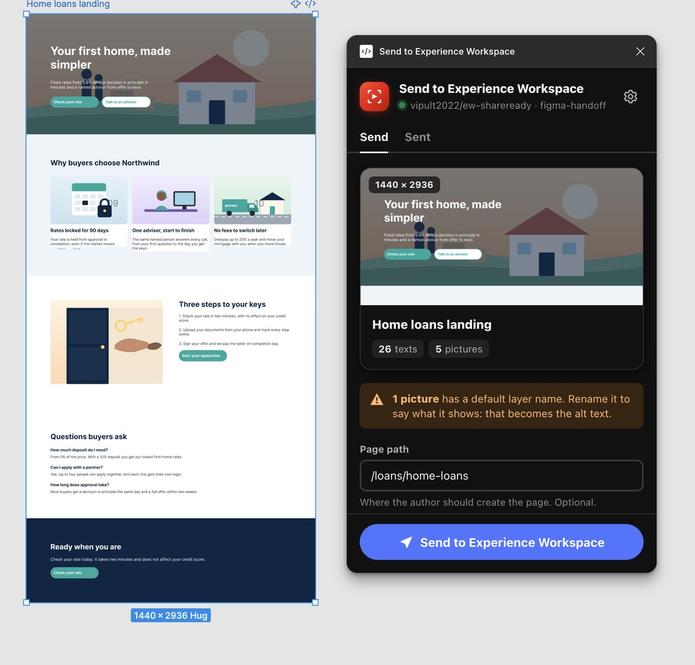
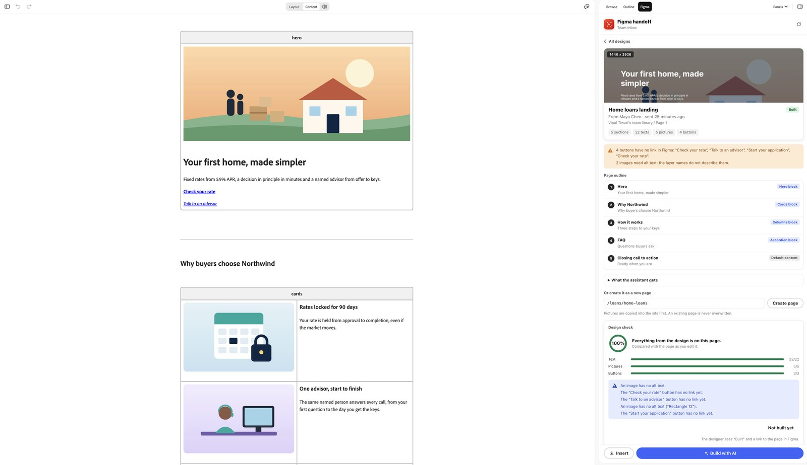
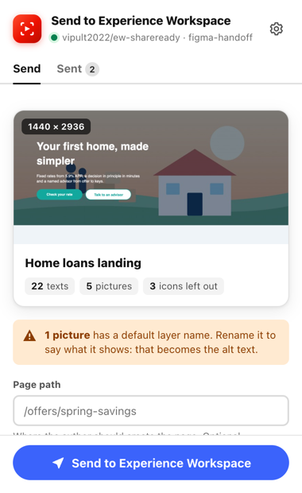
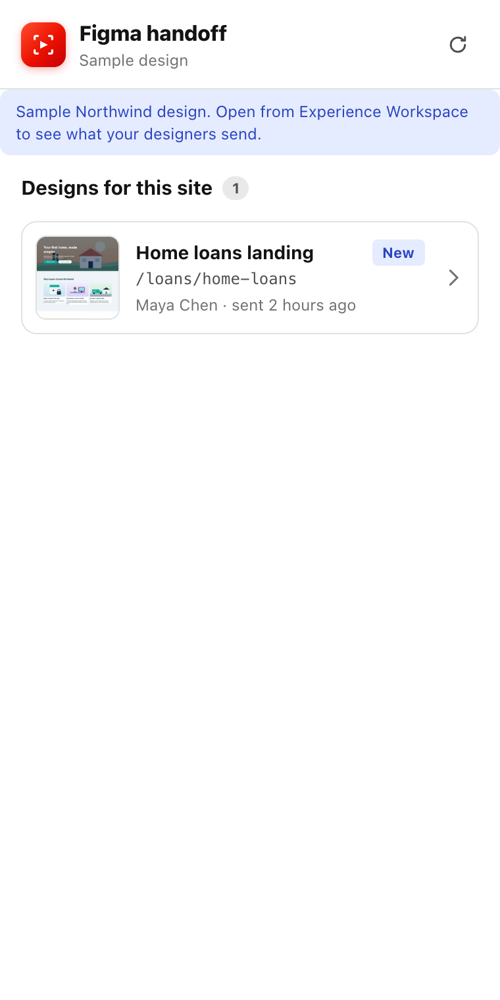
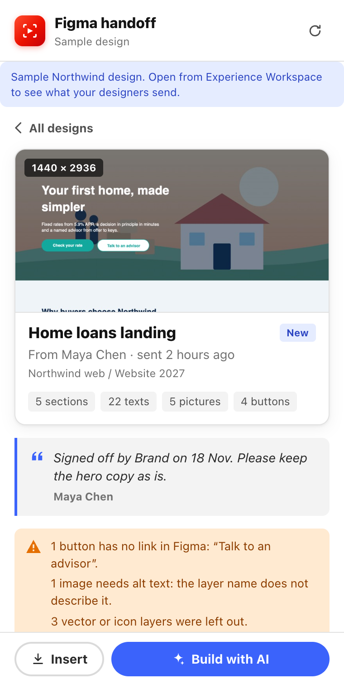
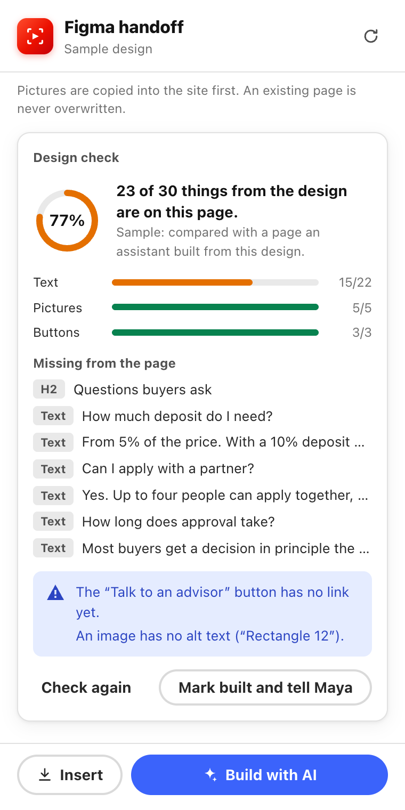
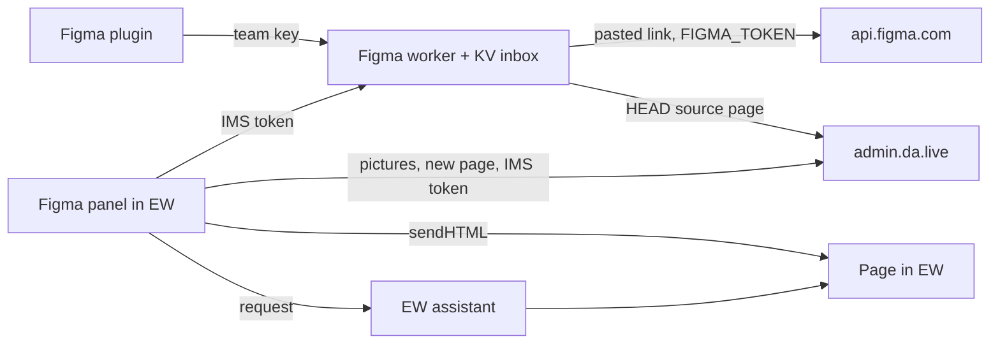
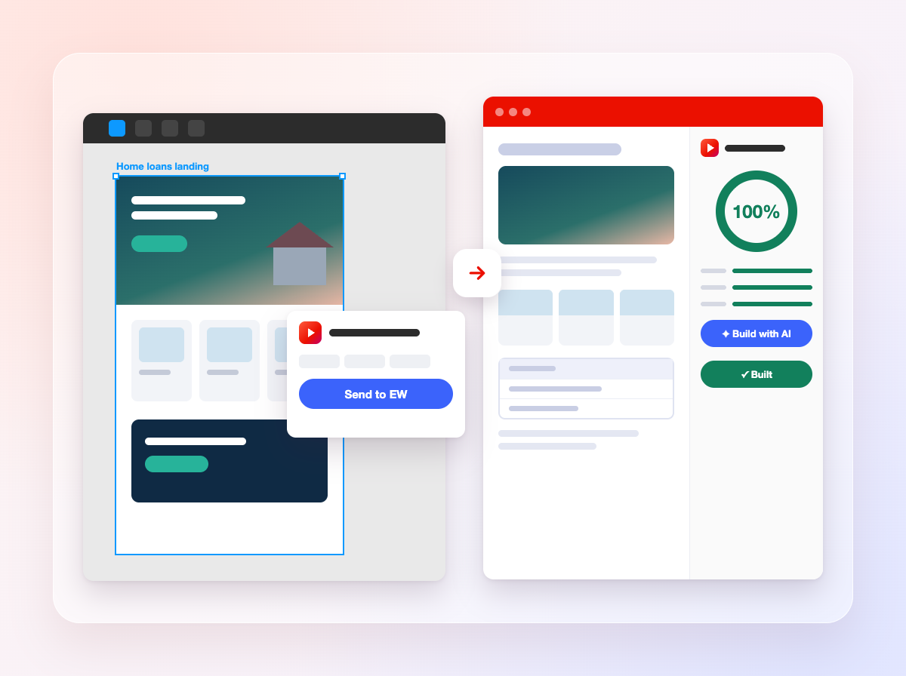

# Figma handoff for Experience Workspace

**Send a finished design from Figma straight to the author who builds the page. The author opens it next to the page in Experience Workspace, has the EW assistant build it with the site's own blocks and the exact copy, checks that nothing from the design is missing, and marks it built. The designer sees it in Figma.**

Today a design handoff is a link in a chat. The author opens the Figma file, hunts for the right frame, copies every heading and paragraph by hand, exports and uploads each picture, guesses which block each band should be, and later the designer asks "is it live yet?". This Experience Workspace (EW) extension for AEM Edge Delivery Services replaces that with two clicks on each side:

- **Designer, in Figma:** select the frame, then **Send to Experience Workspace**. The free plugin sends the layers, the pictures and a thumbnail to the team's inbox.
- **Or the author pastes a Figma link** (optional): if the worker has a Figma token, the author can paste a link to a frame in EW and the worker reads it through Figma's REST API. The designer doesn't need the plugin. See [Paste a Figma link](#paste-a-figma-link-optional).
- **Author, in EW:** open **Extensions › Figma**, pick the design, then **Build with AI**. The panel copies the pictures into the site and hands the EW assistant an outline of the page: sections, suggested blocks, every text word for word, picture URLs and alt text. The **design check** then compares the page with the design and lists anything missing. **Mark built** tells the designer, with a link to the page.

<table>
  <tr>
    <td width="37%"></td>
    <td width="63%"></td>
  </tr>
  <tr>
    <td align="center"><b>Figma desktop</b>: the designer selects the frame and sends it</td>
    <td align="center"><b>Experience Workspace</b>: the page built from it, with the design check at 100%</td>
  </tr>
</table>

Step by step, as in the [panel demo](https://main--ew-shareready--vipult2022.aem.page/tools/figma.html?demo=1):


https://github.com/user-attachments/assets/0f0afcbb-b357-40b0-9085-dc28b3acab48


<table>
  <tr>
    <td width="25%"></td>
    <td width="25%"></td>
    <td width="25%"></td>
    <td width="25%"></td>
  </tr>
  <tr>
    <td align="center"><b>Figma</b>: send the frame</td>
    <td align="center"><b>EW</b>: the site's inbox</td>
    <td align="center"><b>Build</b>: with AI or Insert</td>
    <td align="center"><b>Check</b>: then mark built</td>
  </tr>
</table>

- **Try it now, no setup:** [panel demo with a sample design](https://main--ew-shareready--vipult2022.aem.page/tools/figma.html?demo=1)
- **Third party:** Figma: a Figma plugin that sends designs out, and optionally Figma's REST API to read a pasted link
- **Cost:** free. With the plugin, any Figma plan works, including Starter, and the plugin can run as a private development plugin. Pasting links needs a Figma token from a paid Dev or Full seat to be practical (see [rate limits](#figmas-rate-limits)). The worker fits the Cloudflare Workers free tier.

## Contents

- [What it does](#what-it-does)
- [Try it](#try-it)
- [Install](#install)
- [Set up the worker](#set-up-the-worker)
- [Install the Figma plugin](#install-the-figma-plugin)
- [Paste a Figma link (optional)](#paste-a-figma-link-optional)
- [Configuration](#configuration)
- [How designs are read](#how-designs-are-read)
- [Security](#security)
- [How it works](#how-it-works)
- [Limits](#limits)
- [Troubleshooting](#troubleshooting)
- [Development](#development)
- [Marketplace listing](#marketplace-listing)

## What it does

**In Figma**, the *Send to Experience Workspace* plugin:

1. Shows the selected frame with its size and what will be sent: texts, pictures, and icons that are left out.
2. Warns about pictures whose layer name is a default like *Rectangle 12*, because layer names become alt text.
3. Takes an optional **page path** (`/loans/home-loans`) and a **note for the author** ("Signed off by Brand, keep the hero copy as is"). It remembers both on the frame, so they are filled in next time.
4. Sends it. Sending the same frame again updates the design in the inbox and marks it *Updated*.
5. Lists what you sent under **Sent**, with *New*, *Updated* or *Built*. A built design links to its page.
6. Can **draw a sample design** (the Northwind Bank home loans page), to try everything in an empty file.

**In EW**, the *Figma* panel:

1. Lists the designs sent to this site, newest first, with a thumbnail, status, path, sender and when. If the worker has a Figma token, it also shows **Paste a Figma link**, which brings in a frame without the plugin.
2. Opens a design: thumbnail, counts, the designer's note, warnings (buttons without a link, pictures without alt text, no clear main heading) and the **page outline**: each section with its suggested block.
3. Builds the page in one of three ways:

   | Action | Does |
   | --- | --- |
   | **Build with AI** | Copies the pictures into the site, then sends the EW assistant a request to build the page with the site's blocks, keeping every text exactly as written. Open **What the assistant gets** to read or copy the request first. |
   | **Insert** | Copies the pictures, converts the design to blocks itself and inserts it at the cursor. No AI involved. |
   | **Create page** | Makes a new Document Authoring page at the designer's path (or `/drafts/{name}`) with the converted design. Never overwrites a page. |

4. Runs the **design check** on the open page as you edit: how many texts, pictures and buttons from the design are on the page, and which ones are missing. It also notes buttons that still have no link and images without alt text.
5. **Mark built and tell {designer}** saves the status and the page's link, which the designer sees in the plugin. **Not built yet** undoes it.

### Pictures are copied into the site

The plugin exports picture layers as JPEG, up to 1600 px wide, and sends pictures used as a frame's fill as their original JPEG or PNG file. They are kept in the worker's inbox. Before building, the panel copies each one into the site's Document Authoring media folder (`/media/figma/` by default) with the author's own sign-in, and the page and the assistant only ever use those copies. Names include a short hash, so building again reuses them.

## Try it

The [demo](https://main--ew-shareready--vipult2022.aem.page/tools/figma.html?demo=1) has one sample design, a Northwind Bank home loans page (Northwind Bank is a fictional brand). It needs no EW, Figma account or worker, and nothing is sent anywhere.

| Step | What to do |
| --- | --- |
| 1 | Open **Home loans landing** from the list. |
| 2 | Read the designer's note, the warnings and the page outline: Hero, Cards, Columns, Accordion and a call to action. |
| 3 | Open **What the assistant gets** to see the request the assistant would get, and **Copy request**. |
| 4 | Scroll to the **design check**: 77%, because the sample page was built without the FAQ. The missing heading and questions are listed. |
| 5 | **Build with AI**, **Insert**, **Create page** and **Mark built** work inside EW. |

The demo site is connected to a real worker:

- Edit a page (needs access to the `vipult2022` org): https://da.live/canvas#/vipult2022/ew-shareready/index, then **Extensions › Figma**

## Install

You need:

- an Edge Delivery Services site authored in Document Authoring (da.live) with Experience Workspace, and permission to edit the site config,
- Figma (any plan, including Starter) with the desktop app, to import the plugin,
- a free Cloudflare account for the worker,
- the blocks the designs use (`Hero`, `Cards`, `Columns`, `Accordion`, `Table` by default; see [Configuration](#configuration)).

Setup takes about 15 minutes: the worker, then the panel, then the plugin.

### Option A: use the hosted panel

Open your site config at `https://da.live/config#/{org}/{site}/` and add this row to the **`library`** sheet. If the sheet doesn't exist yet, add it with the **+** button next to the sheet tabs.

| title | path | icon |
| --- | --- | --- |
| Figma | `https://main--ew-shareready--vipult2022.aem.page/tools/figma.html` | `https://main--ew-shareready--vipult2022.aem.page/tools/figma/icon.svg` |

Then [set up the worker](#set-up-the-worker) and add it to the `figma` sheet. Save the config and reload EW. Open a page, then **Extensions › Figma**.

The hosted panel runs in your browser. It talks only to your own worker and to Adobe's APIs with your own sign-in.

### Option B: host your own copy

To pin a version or change the code, copy these into your own site's repository:

```text
tools/figma.html
tools/figma/
```

Then use your own site's URLs in the `library` row (for example `https://main--{site}--{org}.aem.live/tools/figma.html`). The files are plain JavaScript, HTML and CSS with no build step and no dependencies, and the folder needs nothing from the rest of this repo. Add `tools/figma/test/*`, `tools/figma/worker/*`, `tools/figma/docs/*`, `tools/figma/demo/*.mjs` and `tools/figma/plugin/*` to `.hlxignore` so they aren't served.

## Set up the worker

The worker is the inbox between Figma and EW. It stores each design for 30 days in Workers KV. Designers reach it with a shared **team key**; authors reach it with their Adobe sign-in, and only for sites they can read.

1. **Get the code and sign in to Cloudflare** (the free plan is enough):

   ```sh
   git clone https://github.com/vipult2022/ew-shareready.git
   cd ew-shareready/tools/figma/worker
   npx wrangler login
   ```

2. **Create the inbox** and paste the id it prints into `wrangler.toml` (`[[kv_namespaces]]`, `id`):

   ```sh
   npx wrangler kv namespace create HANDOFFS
   ```

3. **Edit `wrangler.toml`.** Set `ALLOWED_ORGS` to your org (`my-org`) or site (`my-org/my-site`).
4. **Add the team key and deploy.** The key is any long random text. Share it with your designers; they paste it into the plugin once.

   ```sh
   openssl rand -hex 24                # a good team key
   npx wrangler secret put HANDOFF_KEY
   npx wrangler deploy
   curl https://figma-handoff.<your-subdomain>.workers.dev/status
   # {"ok":true,"service":"figma","configured":true}
   ```

5. **Connect it to your site.** Add `worker-url` to the `figma` sheet ([Configuration](#configuration)). Until then, the panel shows these steps and a **Try it with a sample design** button.

To change the key later, run `npx wrangler secret put HANDOFF_KEY` again and tell your designers.

## Install the Figma plugin

Each designer does this once, in the Figma desktop app:

1. Download this repository ([ZIP](https://github.com/vipult2022/ew-shareready/archive/refs/heads/main.zip)) and unzip it.
2. In Figma, open any design file, then **Plugins › Development › Import plugin from manifest…** and choose `tools/figma/plugin/manifest.json`.
3. Run **Plugins › Development › Send to Experience Workspace**, open **Settings** (the gear) and fill in:

   | Field | Value |
   | --- | --- |
   | Worker URL | `https://figma-handoff.<your-subdomain>.workers.dev` |
   | Team key | the `HANDOFF_KEY` |
   | Org, Site | your DA org and site, e.g. `my-org`, `my-site` |
   | Your name | shown to authors ("From Maya Chen") |

4. **Test connection**, then **Save**. Settings are kept in Figma on that computer.

To try it without a design, choose **Draw a sample design** in the plugin. It draws the Northwind Bank home loans page in the current file, with its page path and note filled in. One picture is still called "Rectangle 12", so you can see the alt-text warning.

On Figma's Organization or Enterprise plan, an admin can also publish the plugin privately, so designers install it from **Plugins** without the manifest.

## Paste a Figma link (optional)

There are two ways to get a design into EW. Both end in the same inbox, so everything after that (Build with AI, Insert, the design check, Mark built) works the same way.

| | The plugin (designer sends) | Paste a link (author pulls) |
| --- | --- | --- |
| Who acts | The designer, in Figma | The author, in EW |
| Needs | The plugin and the team key | A `FIGMA_TOKEN` on the worker |
| Figma plan | Any, including Starter | A Dev or Full seat on a Professional, Organization or Enterprise plan |
| Figma's rate limits | Don't apply | Apply (see below) |
| Page path and note | Yes | No; the author picks the page |
| Designer sees *Built* | Yes, in the plugin | Only if they also send it with the plugin |

The plugin is the recommended way. Pasting links is handy when the designer only shared a link, or doesn't use the plugin.

### Set it up

1. **Make a token.** In Figma, open **Settings › Security › Personal access tokens**, then **Generate new token** with the **File content: Read only** scope (`file_content:read`) and no other scopes. Use an account that can open your design files, ideally a shared team account with a Dev or Full seat.
2. **Give it to the worker:**

   ```sh
   cd tools/figma/worker
   npx wrangler secret put FIGMA_TOKEN
   ```

3. **Optional: limit which files it reads.** Set `FIGMA_FILES` in `wrangler.toml` to a comma-separated list of file keys (the part after `/design/` in a Figma link), then `npx wrangler deploy`. Without it, the worker reads any file the token can open.
4. Reload the Figma panel in EW. **Paste a Figma link** appears above the designs. `curl {worker-url}/status` shows `"figmaApi":true`.

To get a link, select the frame in Figma, then right-click › **Copy/Paste as › Copy link to selection**. Links to a whole file or page are refused; the link must point at the one frame that holds the page design.

### Figma's rate limits

Figma limits REST API reads per token and per file, depending on the seat of the token's account and the plan of the file. Each pasted link uses three reads: the frame (Tier 1), its pictures (Tier 2, only if it has pictures) and a thumbnail (Tier 1).

| Token's seat | Tier 1 (frame, thumbnail) | Tier 2 (pictures) |
| --- | --- | --- |
| View or Collab | up to 6 a **month** | up to 5 a minute |
| Dev or Full, Professional plan | 10 a minute | 25 a minute |
| Dev or Full, Organization plan | 15 a minute | 50 a minute |
| Dev or Full, Enterprise plan | 20 a minute | 100 a minute |

Files on the **Starter** plan get only about 6 reads a month, whatever the seat. When Figma says no, the panel says whether to wait a few minutes or to use the plugin instead. These numbers are from [Figma's rate limits](https://developers.figma.com/docs/rest-api/rate-limits/) and can change.

### What's different from the plugin

- **Pictures** are the original image files used in the frame, so crops and filters set in Figma aren't applied. Up to 30 different pictures are copied; any that can't be copied are left out and the panel warns about them.
- **Layer names** become alt text, as with the plugin, and vectors and icons are still left out.
- The design has no page path or note. Its id is the same as the plugin's for the same frame when the plugin sends the file key, so the two can update the same design.

## Configuration

The `figma` sheet lives in the site config at `https://da.live/config#/{org}/{site}/`. Only `worker-url` is required.

| key | value | default |
| --- | --- | --- |
| `worker-url` | Your worker, e.g. `https://figma-handoff.my-team.workers.dev`. Required. | |
| `blocks` | The blocks the assistant may use, comma-separated. Set this to your site's blocks. | `Hero, Cards, Columns, Accordion, Table` |
| `image-folder` | Where copied pictures go in Document Authoring. | `/media/figma` |
| `new-page-folder` | Where **Create page** suggests new pages when the designer gave no path. | `/drafts` |

Any setting can also go in the panel URL for testing, for example `tools/figma.html?worker-url=http://localhost:8787`.

## How designs are read

The plugin reads the selected frame into a small layer tree: frames with their position, size, fill and auto layout, texts with their size, weight, colour and link, and pictures. Vectors and icons are left out and counted. The panel then reads that tree:

| In Figma | On the page |
| --- | --- |
| Top-level bands of the frame, top to bottom | sections |
| The text size most text uses | paragraphs; larger sizes become `H1`–`H3`, and only the first `H1` stays one |
| A first band with the main heading and one or two pictures | a `Hero` block |
| 2 or more similar frames in a band | a `Cards` block, one card each |
| 2 to 4 different frames side by side | a `Columns` block |
| A band with a background colour of its own (not the page's) | a `Section Metadata` block: `Style` `dark` when white text reads better on it, otherwise `light` (the hero keeps its own look) |
| Small filled frames with one short label, or frames named like a button (`Button`, `CTA`) | buttons (links), the first one bold |
| Text links | links; only `https:`, `mailto:` and `tel:` |
| Picture layers | pictures, with the layer name as alt text unless it's a default name |
| The main heading (or the frame's name) and the first longer paragraph after it | a `Metadata` block (title, description) |

**Name a band to choose its block.** A frame whose name starts with `Hero`, `Cards`, `Columns`, `Accordion` (or `FAQ`), `Table` or `Text` becomes that block, whatever its layout. This is the most reliable way for designers to say what they mean.

**Build with AI** gets the same outline, so the assistant follows the same blocks, but it can choose a better block when the content clearly fits one, and it writes alt text for pictures with default names (and lists them, so you can check them).

## Security

- **The team key stays in the worker and the plugin.** The browser panel never sees it. Without the key nobody can send designs, and the key only allows sending and listing designs for the orgs in `ALLOWED_ORGS`.
- **Authors use their own sign-in.** Every panel request carries the author's Adobe IMS token, and the worker checks that this token can read the current page through the Document Authoring source API (cached for five minutes). Requests for other orgs or sites, or from origins not in `ALLOWED_ORIGINS`, are refused. Each token or key is limited to 60 requests a minute.
- **Only pictures, checked.** The worker stores only JPEG and PNG files (checked by their first bytes, up to 5 MB each) and serves them with their own type, never as HTML or SVG.
- **The Figma token stays in the worker** and only reads files: it needs just the `file_content:read` scope, and `FIGMA_FILES` can limit it to listed files. Only authors who can read the current page can use it, at 60 requests a minute each. Pictures are downloaded only from Figma's own hosts, over https, up to 10 MB each, and kept only if they are JPEG or PNG.
- **One narrow write back.** The status a panel can set is *built* or *new*, with a link that must point to the author's own site (`da.live/canvas#/{org}/{site}/…` or `*--{site}--{org}.aem.page|live`).
- **No markup injection.** Every text from Figma is escaped, and only `https:`, `mailto:` and `tel:` links are kept. The plugin itself never talks to the network: Figma only lets its window do that, and the window only calls the worker.
- **Pages and pictures** are written to Document Authoring with the author's own sign-in, so they can only go where the author can already write. **Create page** never overwrites an existing page.
- Designs expire from the inbox after 30 days.

## How it works



1. The plugin (`plugin/code.js`) reads the selected frame in Figma's sandbox, exports the pictures and a thumbnail, and passes them to its window (`plugin/ui.html`), which posts them to the worker's `/send`. For a pasted link, the panel posts it to `/import` instead, and the worker reads the frame, its pictures and a thumbnail from Figma's REST API with [`lib/rest.js`](lib/rest.js), which turns Figma's JSON into the same layer tree.
2. The worker gives the design a stable id from the file and frame, and stores the layer tree, pictures and a short summary in KV. The summary is KV metadata, so listing the inbox needs no extra reads.
3. The panel loads the Document Authoring SDK to get the site, the page and the author's sign-in, reads the `figma` sheet, then lists and opens designs through the worker.
4. [`lib/design.js`](lib/design.js) turns the layer tree into sections and blocks, [`lib/convert.js`](lib/convert.js) into Document Authoring HTML, and [`lib/prompt.js`](lib/prompt.js) into the assistant's request.
5. **Build with AI** copies the pictures, then fills the EW assistant with the request and sends it. **Insert** uses `sendHTML`. **Create page** saves a new page with the source API.
6. Inside EW, the panel follows the open document live and reruns [`lib/check.js`](lib/check.js) as it changes. Outside EW, **Read this page** loads the saved page instead.

### Files

| File | What it does |
| --- | --- |
| `../figma.html`, `figma.js`, `panel.js`, `figma.css` | The EW panel |
| `plugin/manifest.json`, `plugin/code.js`, `plugin/ui.html` | The Figma plugin |
| `lib/design.js` | Figma layer tree to sections, blocks, warnings |
| `lib/convert.js` | Sections to Document Authoring HTML, page paths |
| `lib/prompt.js` | The request for the EW assistant |
| `lib/rest.js` | Figma links and Figma's REST API JSON to the layer tree (used by the worker) |
| `lib/check.js` | The design check |
| `lib/images.js` | Copies pictures into Document Authoring |
| `lib/connection.js` | Worker and sample-data connections |
| `lib/config.js` | Reads the `figma` sheet |
| `lib/dom.js` | Small DOM helper for the panel |
| `worker/` | Cloudflare worker with the KV inbox |
| `demo/` | The sample design and its pictures |
| `test/` | Tests |

### Worker API

| Route | Auth | Body | Returns |
| --- | --- | --- | --- |
| `GET /status` | | | `{ ok, service, configured, figmaApi }` |
| `POST /send` | team key | `{ org, site, handoff, images, thumbnail }` | `{ handoff }` (summary) |
| `POST /sent` | team key | `{ org, site }` | `{ handoffs }` |
| `POST /handoffs` | IMS | `{ org, site, path }` | `{ handoffs }` |
| `POST /handoff` | IMS | `{ org, site, path, id }` | `{ handoff }` with its layer tree |
| `POST /import` | IMS | `{ org, site, path, url }` (a Figma frame link) | `{ handoff, dropped }`; needs `FIGMA_TOKEN` |
| `POST /image` | IMS | `{ org, site, path, id, image }` | the picture |
| `POST /status` | IMS | `{ org, site, path, id, status, url }` | `{ handoff }` |

Every `POST` needs `Authorization: Bearer {key or token}`.

## Limits

- **A send** is up to 15 MB: 40 pictures of up to 5 MB each, and a layer tree of up to 1 MB (3,000 layers). The plugin exports pictures at up to 1600 px wide.
- **Up to 100 designs** per site are listed. Designs expire after 30 days; sending again renews them.
- **Workers KV free tier** allows 1,000 writes a day. A send uses one write per picture plus two.
- **A pasted link** copies up to 30 different pictures of up to 10 MB each, and is subject to [Figma's rate limits](#figmas-rate-limits).
- **Layout is a best guess.** Overlapping layers, absolute positioning and deeply nested auto layout can come out in a different order. Name bands after their block to be sure, and use the design check to catch anything missing.
- **Icons, vectors and effects** (shadows, gradients on text) are left out. Export icons as pictures if the page needs them.
- **Insert goes at the cursor.** EW can't replace a block in place, so the panel won't insert inside another block. Click an empty line first.
- **Build with AI** needs EW's assistant. In plain Document Authoring, use **Insert** or **Create page**, or copy the request into any assistant.
- **One team key per worker.** Everyone with the key can send to every site the worker serves. Run one worker per team if you need to keep teams apart.

## Troubleshooting

| Message | What to do |
| --- | --- |
| *Connect Figma to this site* (setup steps) | Add `worker-url` to the `figma` sheet, then reload. |
| *Could not reach the Figma worker* | Check `worker-url` and `curl {worker-url}/status`. |
| *The worker is not set up yet* | Bind the KV namespace in `wrangler.toml` and run `npx wrangler secret put HANDOFF_KEY`, then deploy. |
| Plugin: *That team key is not right* | Paste the current `HANDOFF_KEY` into the plugin settings. |
| *This worker does not serve …* | Add the org or site to `ALLOWED_ORGS` and redeploy. |
| *That design is no longer in the inbox* | It expired or was replaced. Ask the designer to send it again. |
| No **Paste a Figma link** box | The worker has no `FIGMA_TOKEN`. [Set it up](#set-it-up), or use the plugin. |
| *Pasting Figma links is not set up* | Run `npx wrangler secret put FIGMA_TOKEN` in `tools/figma/worker`. |
| *That is not a figma.com link* / *…the whole file, not one frame* | In Figma, select the frame, then right-click › **Copy/Paste as › Copy link to selection**. |
| *Figma's API limit for this file is used up* | The token has a View or Collab seat, or the file is on the Starter plan. Use a Dev or Full seat's token, or the plugin. |
| *Figma is limiting requests* | Wait the minutes shown, or use the plugin. |
| *Figma refused the worker's token* | Make a new token with the `file_content:read` scope from an account that can open the file. |
| *This worker only reads the Figma files listed…* | Add the file key to `FIGMA_FILES` and redeploy. |
| *N pictures could not be brought in from Figma* | Those pictures are left out. Send the frame with the plugin to include them. |
| Plugin: *Select a frame, not a layer* | Select one frame, section, group or component, not a text or a shape. |
| *Your cursor is inside a block* | Click an empty line outside the block, then **Insert** or **Build with AI**. |
| *There is already a page at …* | Change the path, or open that page and use **Insert**. |
| *could not be copied into the site* | Check you can edit the site in Document Authoring, then try again. |
| A picture has the wrong alt text | Rename the layer in Figma to say what it shows, then send again. |
| Blocks show as plain tables on the page | Add the block to your site, or remove it from `blocks`. |

## Development

```sh
npm install
node --test tools/figma/test/    # layout, converter, check, worker and plugin tests
npx eslint tools/figma           # ESLint (airbnb)
npx -y @adobe/aem-cli up         # serves the repo on localhost:3000
```

- **Locally:** open http://localhost:3000/tools/figma.html?demo=1, or `&design=sample-home-loans` to open the sample.
- **Inside EW:** add `?ref=local` to the EW URL to load the extension from `localhost:3000`.
- **Run the worker locally:** `cd tools/figma/worker && npx wrangler dev` (put `HANDOFF_KEY`, and optionally `FIGMA_TOKEN`, in `.dev.vars`), then add `?worker-url=http://localhost:8787` to the panel URL and use the same URL in the plugin settings.
- **Plugin window in a browser:** `plugin/` isn't served by `aem up`, so run `python3 -m http.server 8931` in the repo and open http://localhost:8931/tools/figma/plugin/ui.html to see it without Figma, with `?state=empty`, `selected`, `sent`, `settings` or `success`, and `&theme=dark`.
- `node tools/figma/demo/make-sample.mjs` rebuilds `demo/handoff.json` from the sample design, and the copy embedded in `plugin/ui.html` that **Draw a sample design** uses offline.

## Marketplace listing

| Field | Value |
| --- | --- |
| Title | Figma handoff |
| Description | Send a design from Figma to the author who builds it. Authors open it next to the page, build it with the EW assistant using the site's blocks and the exact copy, check that nothing from the design is missing, and mark it built for the designer to see in Figma. |
| Type | Plugin |
| Category | Extension |
| Status | Early Access |
| Owner | vipult2022 |
| Doc Url | https://github.com/vipult2022/ew-shareready/tree/main/tools/figma#readme |
| Try Url | https://main--ew-shareready--vipult2022.aem.page/tools/figma.html?demo=1 |
| Image | https://main--ew-shareready--vipult2022.aem.page/tools/figma/marketplace.png (1200×896) |
| Logo | https://main--ew-shareready--vipult2022.aem.page/tools/figma/icon.svg |



The Marketplace image is drawn in HTML and CSS. Its source is in [`docs/marketplace.html`](docs/marketplace.html).

## License

[Apache License 2.0](../../LICENSE). Figma is a trademark of Figma, Inc.; this extension is not made or endorsed by Figma. Northwind Bank is a fictional brand used for the demo content.
