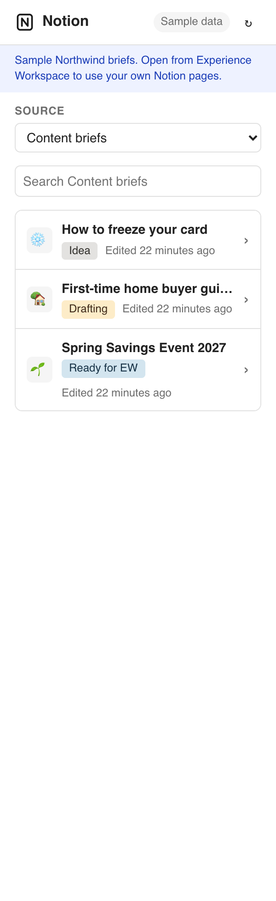
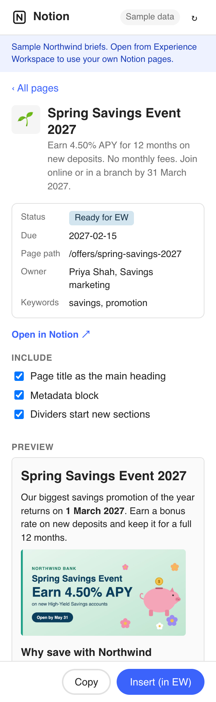
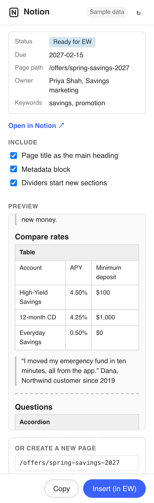
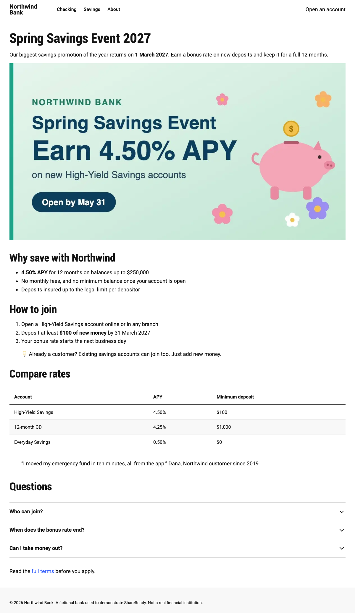
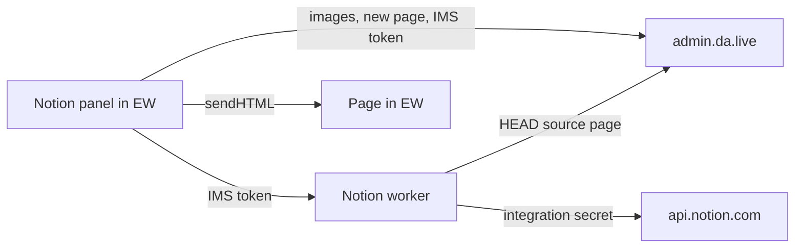
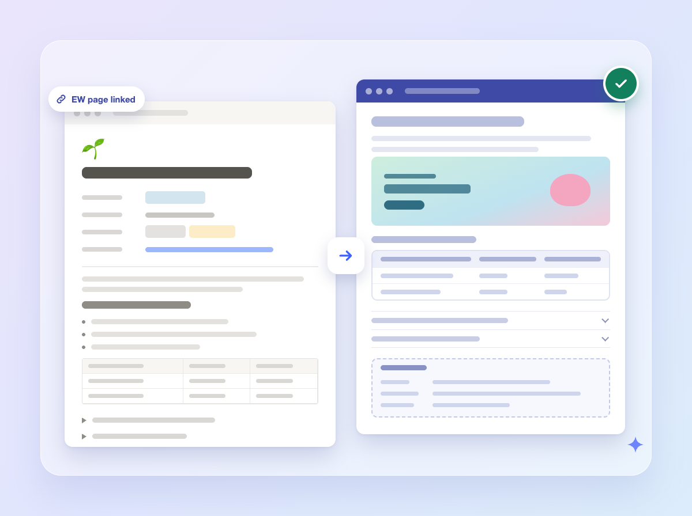

# Notion for Experience Workspace

**Turn a Notion brief or draft into a page: browse your team's Notion pages next to the page you're editing, then insert one at the cursor or create a new page from it in one click, with headings, lists, tables, toggles, images and metadata kept.**

Many teams write briefs and first drafts in Notion, then rebuild them by hand in the CMS. They copy each paragraph, redo every heading and list, download and upload every image, and retype the title, description and keywords into a metadata block. This Experience Workspace (EW) extension for AEM Edge Delivery Services does that in a few clicks. An author opens **Extensions › Notion**, picks a brief from the team's *Content briefs* database and checks the preview. Then they press **Insert** to put it at the cursor, or **Create page** to get a new page with the content, the images copied into the site and a `Metadata` block. The new page's link is written back to the brief in Notion, so the team can see which briefs are done.

<table>
  <tr>
    <td width="33%"></td>
    <td width="33%"></td>
    <td width="33%"></td>
  </tr>
  <tr>
    <td align="center"><b>Browse</b>: briefs and their status</td>
    <td align="center"><b>Check</b>: properties and options</td>
    <td align="center"><b>Preview</b>: insert or create a page</td>
  </tr>
</table>



- **Try it now, no setup:** [panel demo with sample data](https://main--ew-shareready--vipult2022.aem.page/tools/notion.html?demo=1)
- **Third party:** Notion (public API through a small worker, read, plus one optional write: the new page's link)
- **Cost:** free. Any Notion plan works, including Free. The worker fits the Cloudflare Workers free tier.

## Contents

- [What it does](#what-it-does)
- [Try it](#try-it)
- [Install](#install)
- [Connect Notion](#connect-notion)
- [Configuration](#configuration)
- [What gets converted](#what-gets-converted)
- [Security](#security)
- [How it works](#how-it-works)
- [Limits](#limits)
- [Troubleshooting](#troubleshooting)
- [Development](#development)
- [Marketplace listing](#marketplace-listing)

## What it does

1. **Pick a source.** Admins can name the databases authors use (*Content briefs*), and limit each one to some statuses, for example only *Ready for EW*. Authors can also open any database shared with the integration, or search every shared page by title.
2. **Pick a page.** Each row shows the page's icon, title, status and when it was last edited. Search filters the list.
3. **Check it.** The page view shows the page's properties (status, due date, owner, keywords and so on) and an **Open in Notion ↗** link. Three options decide what is added:

   | Option | Does |
   | --- | --- |
   | Title as heading | adds the page title as the `H1`, and moves Notion's headings one level down |
   | Metadata block | adds a `Metadata` block with the title and the page's *Description* and *Keywords* properties |
   | Dividers start sections | turns each Notion divider into a section break |

4. **Preview, then insert or create.** The preview shows exactly what will be added. If something can't be converted, such as a sub-page, the panel lists it above the preview.
   - **Insert** copies the images into the site and puts the content at the cursor.
   - **Create page** makes a new Document Authoring page at the suggested path (from the page's *Page path* property, or `/drafts/{title}`), with the images copied, and links to it. The panel then writes the new page's link into the brief's *EW page* property in Notion.
   - **Copy** puts the content on the clipboard, to paste anywhere.

### Images are copied into the site

Images uploaded to Notion are served from links that expire after an hour, so a page must never point at them. Before inserting or creating a page, the panel downloads each image and saves it to the site's Document Authoring media folder (`/media/notion/` by default) with your own sign-in. Images Notion links to on other sites are fetched through the worker, which only passes on images. Names include a short hash of the image, so inserting the same image again reuses the copy. If an image can't be copied, nothing is inserted and the panel says so.

## Try it

The [demo](https://main--ew-shareready--vipult2022.aem.page/tools/notion.html?demo=1) uses a sample Northwind Bank content briefs database (Northwind Bank is a fictional brand). It needs no EW, Notion account or worker, and nothing is sent anywhere.

| Step | What to do |
| --- | --- |
| 1 | The **Content briefs** list shows three briefs with their status. Search for `home`. |
| 2 | Open **Spring Savings Event 2027**: the status, due date, owner and keywords are shown. |
| 3 | Scroll the preview: headings, lists, a rates table, an FAQ accordion, a callout and an image. Open **First-time home buyer guide** for columns and a checklist. |
| 4 | Untick **Metadata block** or **Title as heading** and watch the preview change. |
| 5 | **Copy**, then paste into any rich text editor. **Insert** and **Create page** work inside EW. |

The demo site is connected to a real Notion workspace with the same database:

- Edit a page (needs access to the `vipult2022` org): https://da.live/canvas#/vipult2022/ew-shareready/index, then **Extensions › Notion**

## Install

You need:

- an Edge Delivery Services site authored in Document Authoring (da.live) with Experience Workspace, and permission to edit the site config,
- a Notion workspace where you can add an integration (any plan, including Free),
- a free Cloudflare account for the worker,
- the `Table`, `Accordion` and `Columns` blocks in your site, if your Notion pages use tables, toggles or columns ([What gets converted](#what-gets-converted)).

Setup takes about 10 minutes.

### Option A: use the hosted copy

Open your site config at `https://da.live/config#/{org}/{site}/` and add this row to the **`library`** sheet. If the sheet doesn't exist yet, add it with the **+** button next to the sheet tabs.

| title | path | icon |
| --- | --- | --- |
| Notion | `https://main--ew-shareready--vipult2022.aem.page/tools/notion.html` | `https://main--ew-shareready--vipult2022.aem.page/tools/notion/icon.svg` |

Then [connect Notion](#connect-notion) and add your worker to the `notion` sheet. Save the config and reload EW. Open a page, then **Extensions › Notion**.

The hosted copy runs in your browser. It talks only to your own worker and to Adobe's APIs with your own sign-in.

### Option B: host your own copy

To pin a version or change the code, copy these into your own site's repository:

```text
tools/notion.html
tools/notion/
blocks/table/       (if your pages have tables)
blocks/accordion/   (if your pages have toggles)
```

Then use your own site's URLs in the `library` row (for example `https://main--{site}--{org}.aem.live/tools/notion.html`). The files are plain JavaScript, HTML and CSS with no build step and no dependencies, and the folder needs nothing from the rest of this repo. Add `tools/notion/test/*`, `tools/notion/worker/*`, `tools/notion/docs/*` and `tools/notion/demo/*.mjs` to `.hlxignore` so they aren't served.

## Connect Notion

Notion's API can't be called from a browser, so the panel talks to Notion through a small Cloudflare worker that holds your integration's secret. The worker only serves people who can read the page they're editing in Document Authoring.

1. **Create the integration.** Open [notion.so/profile/integrations](https://www.notion.so/profile/integrations), choose **New integration**, pick your workspace and keep the type **Internal**. Under **Capabilities**, tick **Read content**. Tick **Update content** too if you want the new page's link written back; otherwise set `ALLOW_WRITE = "no"` in step 4. Copy the **Internal Integration Secret** (`ntn_…`).
2. **Share pages with it.** In Notion, open each database or page authors may use, then **••• › Connections** and add the integration. Pages inside a shared database or page are shared too.
3. **Get the code and sign in to Cloudflare** (the free plan is enough):

   ```sh
   git clone https://github.com/vipult2022/ew-shareready.git
   cd ew-shareready/tools/notion/worker
   npx wrangler login
   ```

4. **Edit `wrangler.toml`.** Set `ALLOWED_ORGS` to your org (`my-org`) or site (`my-org/my-site`). Optionally set `NOTION_DATABASES` to the only database ids the worker may read, `LINK_PROPERTY` to the name of your URL property, or `ALLOW_WRITE = "no"`.
5. **Add the secret and deploy:**

   ```sh
   npx wrangler secret put NOTION_TOKEN
   npx wrangler deploy
   curl https://notion.<your-subdomain>.workers.dev/status
   # {"ok":true,"service":"notion","configured":true,"limitedDatabases":false,"write":true,"linkProperty":"EW page"}
   ```

6. **Connect it to your site.** Add `worker-url` to the `notion` sheet ([Configuration](#configuration)). Until then, the panel shows these steps and a **Try it with sample data** button.

For the link write-back, add a **URL** property named *EW page* (or your `LINK_PROPERTY`) to the database. Without it, everything else still works and the panel says the link wasn't saved.

## Configuration

Both sheets live in the site config at `https://da.live/config#/{org}/{site}/`. Only `worker-url` is required.

### `notion` sheet (settings)

| key | value | default |
| --- | --- | --- |
| `worker-url` | Your worker, e.g. `https://notion.my-team.workers.dev`. Required. | |
| `new-page-folder` | Where **Create page** suggests new pages, when a page has no path property. | `/drafts` |
| `path-property` | The Notion property with the page's path, e.g. `/offers/spring-savings`. | `Page path` |
| `description-property` | The property that becomes the `Description` metadata. | `Description` |
| `keywords-property` | The property that becomes the `Keywords` metadata. | `Keywords` |
| `image-folder` | Where copied images go in Document Authoring. | `/media/notion` |
| `allow-browse` | `no` limits authors to the named sources below. | `yes` |

Any setting can also go in the panel URL for testing, for example `tools/notion.html?worker-url=http://localhost:8787`.

### `notion-sources` sheet (named sources)

Each row is a database authors can pick by name. Without this sheet, authors see every database shared with the integration.

| column | value |
| --- | --- |
| `title` | What authors see, e.g. `Content briefs`. Required. |
| `database` | The database id or its Notion link. Required. To get the link, open the database as a full page and choose **Share › Copy link**. |
| `status` | Optional comma-separated statuses to show, e.g. `Ready for EW, Drafting`. Matches the *Status* property (select or status type). |

The demo site uses:

| title | database | status |
| --- | --- | --- |
| Content briefs | `41d50256e3308108b228fd9122329a60` | |

To create the same demo database in your own workspace, connect your integration (with Read, Update and Insert content) to a page called *Northwind content*, then run `NOTION_TOKEN=ntn_… node tools/notion/demo/setup-northwind.mjs`. Set `NOTION_PAGE` to use another page.

## What gets converted

| In Notion | On the page |
| --- | --- |
| Headings 1–3, paragraphs | headings and paragraphs (one level down when the title is added as `H1`) |
| Bold, italic, strikethrough, inline code, links | the same; only `https:`, `mailto:` and `tel:` links are kept |
| Bulleted, numbered and to-do lists, nested | lists (to-dos as ☐ / ☑) |
| Tables | a `Table` block, or `Table (no header)` |
| Toggles and toggle headings | an `Accordion` block, one item each, neighbours together |
| Columns | a `Columns` block |
| Dividers | section breaks (with **Dividers start sections** off, they are left out) |
| Quotes and callouts | quotes, the callout keeping its emoji |
| Code | a code block |
| Images | pictures, copied into the site, with the caption as alt text |
| Equations | code |
| Bookmarks, embeds, files, PDFs, videos | links |
| Synced blocks | their content |
| Title, *Description*, *Keywords* | a `Metadata` block |
| Sub-pages, inline databases | left out, and listed in the panel |

| Block | Where to get it |
| --- | --- |
| `table` | [`blocks/table`](../../blocks/table) in this repo, or the [Block Collection](https://www.aem.live/developer/block-collection/table) |
| `accordion` | [`blocks/accordion`](../../blocks/accordion) in this repo, or the [Block Collection](https://www.aem.live/developer/block-collection/accordion) |
| `columns` | the [AEM boilerplate](https://github.com/adobe/aem-boilerplate/tree/main/blocks/columns) |

## Security

- **The secret stays in the worker.** The browser never sees it. Every request must carry the author's Adobe IMS token, and the worker checks that this token can read the current page through the Document Authoring source API (cached for five minutes). Requests for orgs or sites not in `ALLOWED_ORGS`, from origins not in `ALLOWED_ORIGINS`, or for databases outside `NOTION_DATABASES` are refused. Each token is limited to 60 requests a minute.
- **Notion decides what can be read.** The integration only sees pages shared with it. Give it **Read content**, and **Update content** only for the link write-back.
- **One narrow write.** The only thing the worker ever writes to Notion is a URL property, and only with a link to a page of the author's own site (`da.live/canvas#/{org}/{site}/…` or `*--{site}--{org}.aem.page|live`). `ALLOW_WRITE = "no"` turns it off.
- **No markup injection.** Every Notion value is escaped, and only `https:`, `mailto:` and `tel:` links are kept. The worker's image route only returns `image/*` files over `https:` (no SVG, up to 20 MB).
- **Pages and images** are written to Document Authoring with the author's own sign-in, so they can only go where the author can already write. **Create page** never overwrites an existing page.

## How it works



1. The panel loads the Document Authoring SDK to get the site, the page and the author's sign-in, then reads the `notion` and `notion-sources` sheets from the site config.
2. Through the worker it lists databases, queries one, searches pages and reads a page's properties and block tree (nested blocks included). Results are cached for a minute; **↻** reloads them.
3. [`lib/convert.js`](lib/convert.js) turns the blocks into Document Authoring HTML, with blocks as tables whose first row is the block name.
4. **Insert** copies the images into `/media/notion/` and inserts the HTML at the cursor with the SDK's `sendHTML`. **Create page** copies the images, saves a new page with the Document Authoring source API and asks the worker to write its link into Notion.

### Files

| File | What it does |
| --- | --- |
| `../notion.html`, `notion.js`, `panel.js`, `notion.css` | The panel |
| `lib/notion.js` | Notion API client, used by the worker |
| `lib/convert.js` | Notion blocks to Document Authoring HTML, page paths |
| `lib/connection.js` | Worker and sample-data connections |
| `lib/images.js` | Copies images into Document Authoring |
| `lib/config.js` | Reads the config sheets |
| `lib/dom.js` | Small DOM helper for the panel |
| `worker/` | Cloudflare worker that holds the integration secret |
| `demo/` | Sample data and the script that creates the demo database |
| `test/` | Tests |

### Worker API

| Route | Body | Returns |
| --- | --- | --- |
| `GET /status` | | `{ ok, service, configured, limitedDatabases, write, linkProperty }` |
| `POST /databases` | `{ org, site, path }` | `{ databases: [{ id, url, title, description, icon, properties }] }` |
| `POST /database` | `{ org, site, path, database }` | `{ database, pages: [{ id, url, title, icon, lastEdited, database, properties }], more }` |
| `POST /search` | `{ org, site, path, query }` | `{ pages, more }` |
| `POST /page` | `{ org, site, path, page }` | `{ page, blocks, truncated }` |
| `POST /link` | `{ org, site, path, page, url }` | `{ ok, property, url }` |
| `POST /file` | `{ org, site, path, url }` | the image |

Every `POST` needs `Authorization: Bearer {IMS token}`.

## Limits

- **Notion's rate limit** is about 3 requests a second per integration. The worker retries when Notion asks it to wait, and caches results for a minute.
- **Up to 200 pages** per database and 50 search results. Use `status` in `notion-sources` to narrow big databases.
- **Up to 1,000 blocks** and 6 levels of nesting per page. The panel warns when the end of a page was left out.
- **A snapshot, not a sync.** Inserted content is ordinary page content. If the Notion page changes, insert again. This keeps the page fast and lets authors edit the copy.
- **Insert goes at the cursor.** EW can't replace a block in place, so the panel won't insert inside another block. Click an empty line first.
- **One shared integration.** Everyone using the worker sees what the integration can see. Notion OAuth, so each author uses their own access, would be a good next step.

## Troubleshooting

| Message | What to do |
| --- | --- |
| *Connect Notion* (setup steps) | Add `worker-url` to the `notion` sheet, then reload. |
| *Could not reach the Notion worker* | Check `worker-url` and `curl {worker-url}/status`. |
| *The worker is not set up yet* | Run `npx wrangler secret put NOTION_TOKEN` in `worker/`. |
| *Notion did not accept the integration secret* | The secret was regenerated or the integration removed. Put the new secret in the worker. |
| *Notion could not find that database* | Share the database with the integration (**••• › Connections**), and check the id in `notion-sources`. |
| *This worker does not serve …* | Add the org or site to `ALLOWED_ORGS` and redeploy. |
| *Your cursor is inside a block* | Click an empty line outside the block, then **Insert**. |
| *There is already a page at …* | Change the path, or open that page and use **Insert**. |
| *could not be copied into the site* | Check you can edit the site in Document Authoring, then try again. |
| *Not linked in Notion: …* | Add a URL property named *EW page* (or `LINK_PROPERTY`) and give the integration **Update content**. |
| Blocks show as plain tables on the page | Add the `table`, `accordion` or `columns` block to your site. |

## Development

```sh
npm install
node --test tools/notion/test/   # converter, config, connection and worker tests
npx eslint tools/notion          # ESLint (airbnb)
npx -y @adobe/aem-cli up         # serves the repo on localhost:3000
```

- **Locally:** open http://localhost:3000/tools/notion.html?demo=1.
- **Inside EW:** add `?ref=local` to the EW URL to load the extension from `localhost:3000`.
- **Run the worker locally:** `cd tools/notion/worker && npx wrangler dev` (put `NOTION_TOKEN` in `.dev.vars`), then add `?worker-url=http://localhost:8787` to the panel URL.

## Marketplace listing

| Field | Value |
| --- | --- |
| Title | Notion |
| Description | Turn Notion briefs and drafts into pages. Browse your team's Notion databases next to the page, then insert a page at the cursor or create a new page from it, with headings, lists, tables, toggles, images and metadata kept, and the link written back to Notion. |
| Type | Plugin |
| Category | Extension |
| Status | Early Access |
| Owner | vipult2022 |
| Doc Url | https://github.com/vipult2022/ew-shareready/tree/main/tools/notion#readme |
| Try Url | https://main--ew-shareready--vipult2022.aem.page/tools/notion.html?demo=1 |
| Image | https://main--ew-shareready--vipult2022.aem.page/tools/notion/marketplace.png (1200×896) |
| Logo | https://main--ew-shareready--vipult2022.aem.page/tools/notion/icon.svg |



The Marketplace image is drawn in HTML and CSS. Its source is in [`docs/marketplace.html`](docs/marketplace.html).

## License

[Apache License 2.0](../../LICENSE). Notion is a trademark of Notion Labs, Inc.; this extension is not made or endorsed by Notion. Northwind Bank is a fictional brand used for the demo content.
