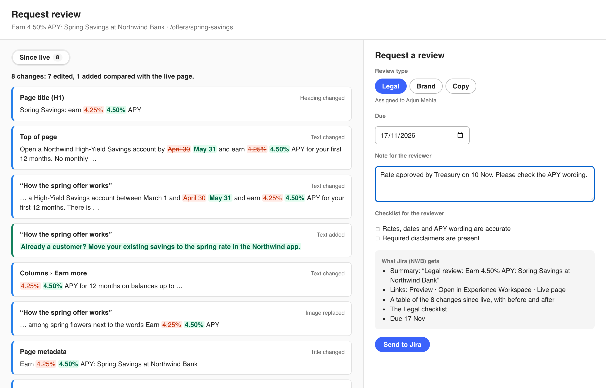
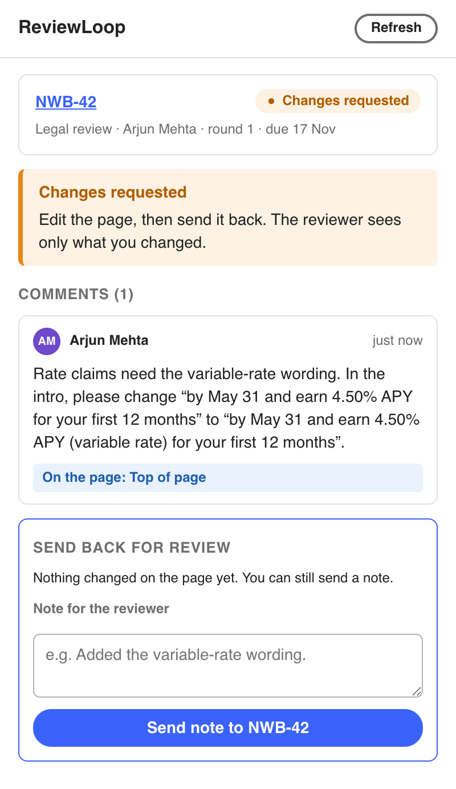
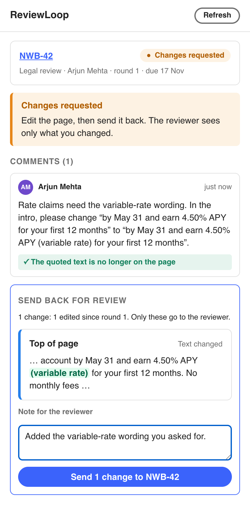
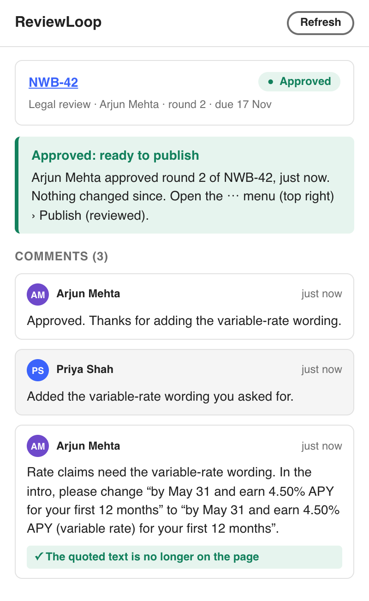
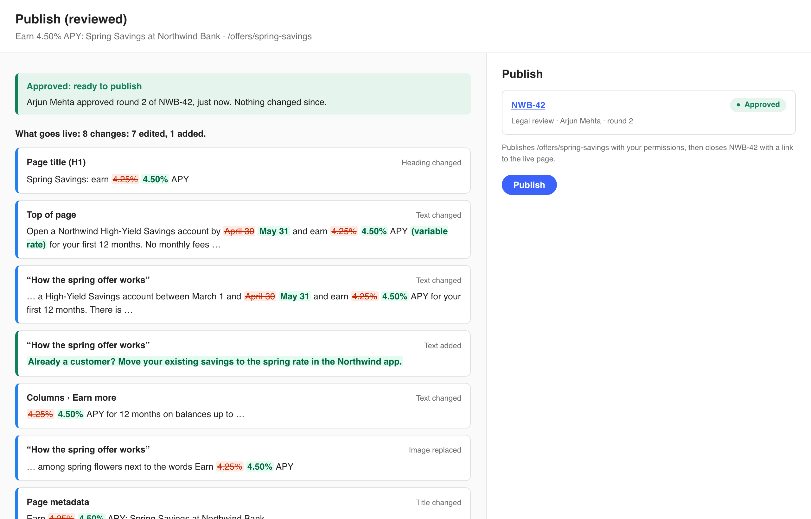
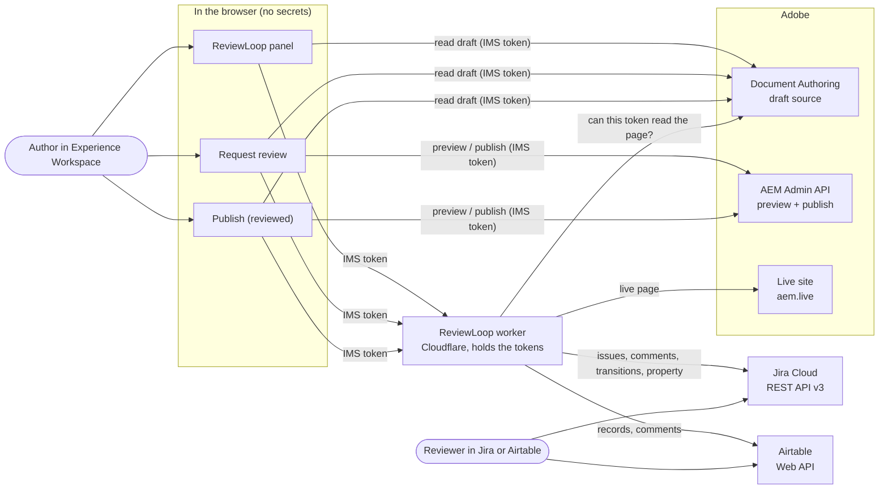
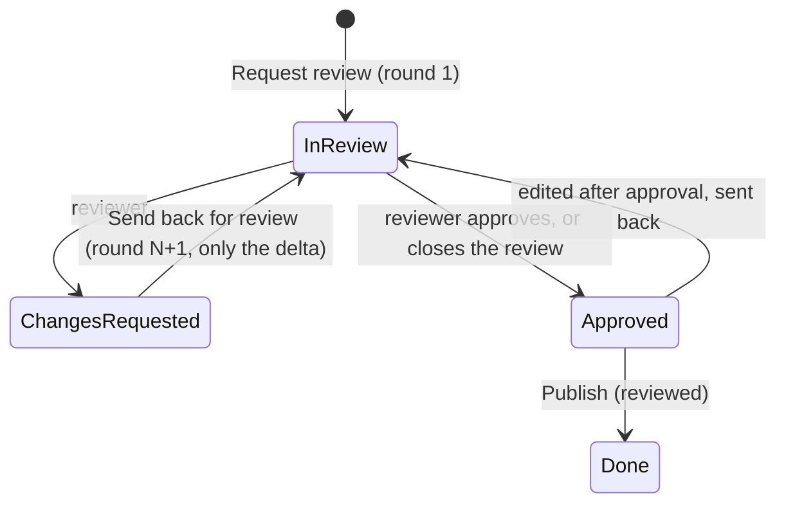

# ReviewLoop for Jira and Airtable

**Send only what changed on a page to Jira or Airtable for legal, brand or copy review, see the reviewer's verdict and comments next to the page, and publish once it's approved, all without leaving Experience Workspace.**

ReviewLoop is an Experience Workspace (EW) extension for AEM Edge Delivery Services. An author picks **Request review** from the Prepare menu. ReviewLoop compares the draft with the live page and opens a Jira issue or an Airtable record that holds only the changes, each with before and after and the removed words struck through, plus a checklist, a due date, an assignee and links back to the page. The reviewer works in Jira or Airtable as usual. The ReviewLoop panel in EW shows their status and comments next to the page and points at the text each comment quotes. When the author makes the fix and sends it back, the reviewer gets *only the changes since the last round*. **Publish (reviewed)** then checks the approval, publishes the page, and closes the review with a link to the live page. Each review type picks its tracker, so Legal can work in Jira while Brand works in Airtable, or a site can use just one.


https://github.com/user-attachments/assets/621f4787-b844-43c7-bf3e-fb0925e5c864




<table>
  <tr>
    <td width="33%"></td>
    <td width="33%"></td>
    <td width="33%"></td>
  </tr>
  <tr>
    <td align="center"><b>1. Feedback</b>: the reviewer's comment, located on the page</td>
    <td align="center"><b>2. Resubmit</b>: only the change since round 1</td>
    <td align="center"><b>3. Approved</b>: ready to publish</td>
  </tr>
</table>



- **Try it now, no setup:** [panel demo](https://main--ew-shareready--vipult2022.aem.page/tools/reviewloop/panel.html?demo=1) · [Request review demo](https://main--ew-shareready--vipult2022.aem.page/tools/reviewloop/request.html?demo=1) · [Publish (reviewed) demo](https://main--ew-shareready--vipult2022.aem.page/tools/reviewloop/publish.html?demo=1)
- **Third party:** Atlassian Jira Cloud (REST API v3) and/or Airtable (Web API: records and comments)
- **Cost:** free. Jira Cloud Free (up to 10 users), Airtable Free (see [its API limit](#limits)) and the Cloudflare Workers free tier are enough.

## Contents

- [Why](#why)
- [What it does](#what-it-does)
- [Try it](#try-it)
- [Install](#install)
- [Set up Jira](#set-up-jira)
- [Set up Airtable](#set-up-airtable)
- [Set up the worker](#set-up-the-worker)
- [Configuration](#configuration)
- [Security](#security)
- [How it works](#how-it-works)
- [Limits](#limits)
- [Troubleshooting](#troubleshooting)
- [Development](#development)
- [Marketplace listing](#marketplace-listing)

## Why

Regulated teams (banks, insurers, pharma) can't publish a rate, a claim or a disclaimer until legal or brand has signed it off. Today that review happens outside the editor:

- The author pastes a preview link into a Jira ticket or an email and writes "please review".
- The reviewer has to read the **whole page** and guess what changed since the version they last approved.
- Comments come back in Jira, so the author switches between tabs and hunts for the sentence each one is about.
- After the fix, the reviewer reads the whole page again, because nobody can tell them which lines changed in round 2.
- Nothing connects "approved" to "published", so pages go live with edits that were made *after* the approval.

ReviewLoop turns this into a loop inside EW: **request review → reviewer sees only the diff → author sees the verdict in place → resubmit only the delta → publish with the approval checked.**

## What it does

ReviewLoop adds three screens to EW. All of them are plain web pages loaded through the [DA SDK](https://www.aem.live/docs/ew/developing/apps-plugins).

### 1. Request review (Prepare menu)

Open the page in EW, then **⋯ (top right) › Request review**. The dialog shows:

- **The changes since live**, as cards: which block or section, what kind of change (text, heading, link, image, metadata, added, removed), and the edit with removed words struck through. A brand-new page is sent as "first version".
- **Review type** from your config (for example Legal, Brand, Copy). Each type has its own assignee, checklist and due date in working days.
- **Due date** and an optional **note for the reviewer**.
- **What Jira will get**, in plain words, before you send.

**Send to Jira** creates one issue in your project with:

- a summary such as *Legal review: /offers/summer-savings*,
- a description with a table of every change, before and after,
- the checklist for that review type,
- the assignee and due date,
- links to **Edit in Experience Workspace** and **Preview** (the dialog re-previews the page first, so the reviewer's link is current),
- the labels `reviewloop` and `rl-{hash of the page}`, and
- the issue moved to your "in review" status.

With Airtable, the review type's tracker is `airtable` and **Send to Airtable** creates one record in the Reviews table instead: the same summary, links, checklist, due date and reviewer, with the changes as a list (~~removed~~ and **added** words), and Status set to *In review*. The rest of this page says "issue"; for Airtable read "record".

If the page already has an open review, the dialog switches to **Send back for review** for that issue instead of creating a second one.

### 2. ReviewLoop panel (Extensions menu)

Open **Extensions › ReviewLoop**. The panel sits next to the page and shows:

- **Status** of the page's review: *Not sent for review*, *In review*, *Changes requested*, *Approved* or *Done*, with the Jira key, assignee, round and due date, and a link to the issue.
- **Clear next step.** For example "Changes requested: edit the page, then send it back. The reviewer sees only what you changed." or "Approved: ready to publish. Maximus (Legal) approved round 2 of NWB-1, 5 min ago. Nothing changed since. Open the ⋯ menu (top right) › Publish (reviewed)."
- **The reviewer's comments.** When a comment quotes text from the page (`change “5.25% APY” to …`), ReviewLoop finds that text in the draft and shows where it is (*On the page: Hero › paragraph*), or *✓ The quoted text is no longer on the page* once it's fixed.
- **Changes since the last round**, and a **Send back for review** button with a note. Jira gets a comment with only those changes, and the issue moves back to "in review" as round N+1.
- **Approved, then edited.** If the page changes after approval, the panel says so and lists the unreviewed edits.

The panel reads the saved draft straight from Document Authoring, so an edit shows within seconds. It checks again every 15 seconds (60 for Airtable), whenever you come back to the tab, and when you press **↻**.

### 3. Publish (reviewed) (Prepare menu)

**⋯ › Publish (reviewed)** compares the draft with the approved round and the live page, then shows one of:

| Situation | What you see | Button |
| --- | --- | --- |
| Approved, nothing changed since | **Approved: ready to publish** | Publish |
| Approved, then edited | **Approved, then edited**, with the unreviewed changes | Publish anyway |
| Still in review or changes requested | **Not approved yet** | Publish anyway |
| Never sent for review | **Not reviewed** | Publish anyway |
| Draft matches live | **Nothing new to publish** | Publish |

With `require-approval` set to `true`, the **Publish anyway** cases are disabled ("Approval required").

Publishing calls the AEM Admin API (preview, then live) with your own sign-in. ReviewLoop then adds a comment to the Jira issue with the live URL (and, if you published without approval, says so), adds a **Live page** link, and moves the issue to Done.

### Closing the review counts as approval

Reviewers don't always use the "Approved" column. The same applies to an Airtable record set to **Done**. If they move the issue straight to **Done** (or any status in Jira's *Done* category) before ReviewLoop published the page, ReviewLoop treats it as approved: *"Maximus (Legal) approved round 1 by closing NWB-1 in Jira."* It only counts as **Done** once Publish (reviewed) has published the page.

## Try it

The demos use a sample Northwind Bank page (a fictional brand). They need no EW, sign-in, Jira or worker. Nothing is sent anywhere; the three screens share their demo state in your browser's local storage.

| Step | Demo | What to do |
| --- | --- | --- |
| 1 | [Request review](https://main--ew-shareready--vipult2022.aem.page/tools/reviewloop/request.html?demo=1) | See the changes to *Spring Savings* since live. Pick **Legal**, add a note, **Send to Jira**. |
| 2 | [Panel](https://main--ew-shareready--vipult2022.aem.page/tools/reviewloop/panel.html?demo=1) | The demo bar lets you play the reviewer, Arjun Mehta. Click **Request changes**: his comment quotes the APY sentence and the panel shows where it is on the page. |
| 3 | Panel | Click **Make the fix**. The comment shows *✓ The quoted text is no longer on the page*, and the panel lists only the fix "since round 1". **Send back for review**. |
| 4 | Panel | Click **Approve**. The panel says *Approved: ready to publish*. |
| 5 | [Publish (reviewed)](https://main--ew-shareready--vipult2022.aem.page/tools/reviewloop/publish.html?demo=1) | Shows the approval and **Publish**. Use **Reset** in the panel to start again. |

The live demo site, with a real Jira project behind it:

- Page: https://main--ew-shareready--vipult2022.aem.page/offers/summer-savings
- Edit (needs access to the `vipult2022` org): https://da.live/canvas#/vipult2022/ew-shareready/offers/summer-savings

## Install

You need:

- an Edge Delivery Services site authored in Document Authoring (da.live) with Experience Workspace, and permission to edit the site config,
- a Jira Cloud site where you can create a project and an API token ([Set up Jira](#set-up-jira)), or an Airtable base and a personal access token ([Set up Airtable](#set-up-airtable)), or both,
- a free Cloudflare account for the worker that holds the tokens ([Set up the worker](#set-up-the-worker)).

Unlike ShareReady's previews, ReviewLoop always needs the worker, because every screen talks to the tracker. Setup takes about 20 minutes.

### Option A: use the hosted copy

Open your site config at `https://da.live/config#/{org}/{site}/` and add the rows below. If a sheet doesn't exist yet, add it with the **+** button next to the sheet tabs.

**`library` sheet:** adds the panel to the Extensions menu.

| title | path | icon | experience |
| --- | --- | --- | --- |
| ReviewLoop | `https://main--ew-shareready--vipult2022.aem.page/tools/reviewloop/panel.html` | `https://main--ew-shareready--vipult2022.aem.page/tools/reviewloop/icon.svg` | `inline` |

**`prepare` sheet:** adds the two dialogs to the Prepare menu (the **⋯** button next to Publish).

| title | path | icon | experience |
| --- | --- | --- | --- |
| Request review | `https://main--ew-shareready--vipult2022.aem.page/tools/reviewloop/request.html` | `https://main--ew-shareready--vipult2022.aem.page/tools/reviewloop/icon.svg` | `fullsize-dialog` |
| Publish (reviewed) | `https://main--ew-shareready--vipult2022.aem.page/tools/reviewloop/publish.html` | `https://main--ew-shareready--vipult2022.aem.page/tools/reviewloop/icon.svg` | `fullsize-dialog` |

**`reviewloop` and `reviewloop-types` sheets:** point at your worker and describe your review types. See [Configuration](#configuration).

Save the config and reload EW. Open a page, then **Extensions › ReviewLoop**.

The hosted copy runs in your browser. It talks only to Adobe's APIs (with your own sign-in) and to the worker URL you configure.

### Option B: host your own copy

To pin a version or change the code, copy this folder into your own site's repository:

```text
tools/reviewloop/
```

Then use your own site's URLs in the `library` and `prepare` rows (for example `https://main--{site}--{org}.aem.live/tools/reviewloop/panel.html`). The files are plain JavaScript, HTML and CSS with no build step and no dependencies. Add `tools/reviewloop/test/*`, `tools/reviewloop/worker/*` and `tools/reviewloop/docs/*` to `.hlxignore` so they aren't served.

## Set up Jira

1. **Create a project.** Any Jira Cloud project works; a Kanban (team-managed or company-managed) software project is the simplest. The demo uses project **NWB** ("Northwind Web").
2. **Give it four statuses**, one per ReviewLoop state. Columns can be called anything; what matters is the **status** each column maps to.

   | ReviewLoop state | Default status name | Demo board (built-in statuses) |
   | --- | --- | --- |
   | In review | `In review` | `In Progress` |
   | Changes requested | `Changes requested` | `Open` |
   | Approved | `Approved` | `Resolved` |
   | Done | `Done` | `Done` |

   If your statuses have other names, set the `JIRA_STATUS_*` variables on the worker. The workflow must allow moving between them (team-managed boards allow any move by default).
3. **Pick the account ReviewLoop acts as.** Issues are created, commented on and moved as this account. Use a shared or bot account in production, so reviews don't depend on one person. It needs permission to browse, create, edit, comment on, assign and transition issues in the project.
4. **Create an API token** for that account at https://id.atlassian.com/manage-profile/security/api-tokens. Keep it for the worker step; never put it in the site config or the browser.
5. **Invite your reviewers** to the project. The `assignee` in `reviewloop-types` is matched against their Jira display name or email.

## Set up Airtable

Skip this if you only use Jira. Airtable suits teams whose reviewers already plan work in a base, or who don't have Jira.

1. **Create a base** (for example "Northwind reviews") in a free Airtable workspace. Copy its id: the `app…` part of the base URL.
2. **Create a personal access token** at https://airtable.com/create/tokens with these scopes, and give it access to that base:

   | Scope | Why |
   | --- | --- |
   | `data.records:read`, `data.records:write` | Find, create and update review records |
   | `data.recordComments:read`, `data.recordComments:write` | Read the reviewer's comments, add round and publish notes |
   | `schema.bases:read` | Check the table in `/status` and build record links |
   | `schema.bases:write` | Only for the setup script below; you can remove it afterwards |

   The token acts as its owner. Use a shared or bot account in production, so reviews don't depend on one person.
3. **Create the Reviews table** with the setup script (Node 18+). It creates the table, or adds any missing columns, and prints the table id:

   ```sh
   cd ew-shareready/tools/reviewloop/worker
   AIRTABLE_TOKEN=pat... AIRTABLE_BASE_ID=app... node setup-airtable.mjs
   ```

   | Column | Type | Set by |
   | --- | --- | --- |
   | Review | Single line text (primary) | ReviewLoop: "Legal review: Spring Savings" |
   | Status | Single select: In review, Changes requested, Approved, Done | ReviewLoop and the **reviewer** |
   | Review type, Reviewer, Due, Page | Text, text, date, text | ReviewLoop |
   | Page key | Single line text | ReviewLoop. Ties the record to one page; don't edit it |
   | Preview, Edit in EW, Live page | URL | ReviewLoop |
   | Description | Long text (rich text) | ReviewLoop: the changes since live, removed words ~~struck through~~, added words in **bold** |
   | ReviewLoop data | Long text | ReviewLoop: round and reviewed snapshot as JSON. Hide it in your views |

4. **Optional: record who approved, and when.** Airtable's API can't create these field types, so add them by hand: a **Last modified time** field named `Status changed` and a **Last modified by** field named `Status changed by`, both set to watch only **Status**. Without them, the panel says "Arjun Mehta approved" using the Reviewer column and leaves out the time.
5. **Optional: add a Kanban view** grouped by Status, so reviewers drag cards from *In review* to *Approved* or *Changes requested*. Reviewers comment on the record (the comment icon in the expanded record), and can @mention the author.
6. **Share the base** with your reviewers. The `assignee` in `reviewloop-types` is written to the Reviewer column as text.

Status options can have other names: set the `AIRTABLE_STATUS_*` variables on the worker (and when running the setup script).

## Set up the worker

The worker is a small Cloudflare Worker (`tools/reviewloop/worker/`) that holds the Jira and Airtable tokens and checks every caller's Adobe sign-in. The free plan is plenty.

### 1. Get the code and sign in to Cloudflare

```sh
git clone https://github.com/vipult2022/ew-shareready.git
cd ew-shareready/tools/reviewloop/worker
npx -y wrangler login
```

### 2. Edit `wrangler.toml`

| Variable | Required | Example | Meaning |
| --- | --- | --- | --- |
| `ALLOWED_ORGS` | Yes | `my-org` or `my-org/my-site` | Comma-separated orgs or sites the worker reviews for. |
| `JIRA_BASE_URL` | For Jira | `https://my-team.atlassian.net` | Your Jira Cloud site. |
| `JIRA_PROJECT` | For Jira | `WEB` | The project key reviews go to. |
| `JIRA_ISSUE_TYPE` | No | `Task` (default) | Issue type for new reviews. |
| `JIRA_STATUS_REVIEW` | No | `In review` (default) | Status for "in review". |
| `JIRA_STATUS_CHANGES` | No | `Changes requested` (default) | Status for "changes requested". |
| `JIRA_STATUS_APPROVED` | No | `Approved` (default) | Status for "approved". |
| `JIRA_STATUS_DONE` | No | `Done` (default) | Status after publishing. |
| `AIRTABLE_BASE_ID` | For Airtable | `appXXXXXXXXXXXXXX` | The base that holds reviews. |
| `AIRTABLE_TABLE` | No | `Reviews` (default) | The table name or its `tbl…` id. |
| `AIRTABLE_STATUS_REVIEW`, `_CHANGES`, `_APPROVED`, `_DONE` | No | `In review`, `Changes requested`, `Approved`, `Done` (defaults) | Status options, if you renamed them. |
| `DEFAULT_TRACKER` | No | `jira` or `airtable` | Where review types without a `tracker` go. Default: Jira if connected, else Airtable. |
| `ALLOWED_ORIGINS` | No | `https://da.live,https://*.da.live` | Browser origins that may call the worker. Default: `https://da.live`, `https://*.da.live`, `https://*.aem.page`, `https://*.aem.live`, `http://localhost:3000`. |

### 3. Add the secrets and deploy

```sh
npx wrangler secret put JIRA_EMAIL       # Jira: the Atlassian account the token belongs to
npx wrangler secret put JIRA_API_TOKEN   # Jira: the API token from Set up Jira
npx wrangler secret put AIRTABLE_TOKEN   # Airtable: the personal access token from Set up Airtable
npx wrangler deploy
```

Wrangler prints the worker URL, for example `https://reviewloop.{your-subdomain}.workers.dev`. Check it:

```sh
curl https://reviewloop.{your-subdomain}.workers.dev/status
# {"ok":true,"name":"reviewloop","default":"jira",
#  "trackers":[{"id":"jira","name":"Jira","ready":true},{"id":"airtable","name":"Airtable","ready":true}],
#  "jira":{"site":"https://my-team.atlassian.net","project":"WEB","projectName":"Website"},
#  "airtable":{"base":"app…","table":"Reviews","tableId":"tbl…","url":"https://airtable.com/app…/tbl…"}}
```

If a status name doesn't exist, `/status` lists it under `jira.missingStatuses` or `airtable.missingStatuses`, along with the ones that do exist. Missing Airtable columns are listed under `airtable.missingFields`. A tracker that is set up but can't be reached shows `"ready":false` with the reason.

### 4. Connect it to your site

Put the worker URL in the `worker-url` row of the `reviewloop` sheet (see below), save, and reload EW.

## Configuration

Two sheets in the site config (`https://da.live/config#/{org}/{site}/`). Jira and Airtable themselves (site, project, base, tokens, statuses) are configured only on the worker.

**`reviewloop` sheet** (columns `key`, `value`):

| key | value | Default | Meaning |
| --- | --- | --- | --- |
| `worker-url` | `https://reviewloop.{your-subdomain}.workers.dev` | none | Your worker. Required. |
| `due-days` | `2` | `2` | Working days until a review is due, when a type doesn't set its own. |
| `require-approval` | `true` or `false` | `false` | `true` disables **Publish anyway** in Publish (reviewed). |
| `tracker` | `jira` or `airtable` | the worker's `DEFAULT_TRACKER` | Where this site's reviews go, when a type doesn't set its own. |

**`reviewloop-types` sheet** (one row per review type):

| type | assignee | checklist | due-days | tracker |
| --- | --- | --- | --- | --- |
| Legal | Jane Doe | Rates, dates and claims are accurate; Required disclaimers are present | 2 | jira |
| Brand | Brand team | Tone of voice; Imagery and alt text | 2 | airtable |
| Copy | | Spelling and grammar; Headings and links | 1 | |

- `assignee` is a Jira display name or email (matched to a Jira user), or the name written to Airtable's Reviewer column. Leave it empty to leave the review unassigned.
- `tracker` (optional) is `jira` or `airtable`. Empty means the `reviewloop` sheet's `tracker`, then the worker's default. A page has one open review at a time, whichever tracker it is in.
- `checklist` items are separated by `;` or new lines.
- Without this sheet, ReviewLoop offers Legal, Brand and Copy with no assignee.

When testing, add `?worker-url=…` to a dialog or panel URL to override the sheet.

## Security

- **Tracker tokens stay on the server.** `JIRA_EMAIL`, `JIRA_API_TOKEN` and `AIRTABLE_TOKEN` live only in Cloudflare's encrypted secrets. The browser never sees them.
- **Every request is tied to an author.** The panel and dialogs send the author's Adobe IMS token, the same one EW uses. The worker checks it by reading the page through the Document Authoring API (`HEAD admin.da.live/source/{org}/{site}{path}.html`, or the newer AEM source API). If the author can't read the page, the worker refuses the request. The token is used only for that check and to show the author's name on the review; the worker keeps a SHA-256 hash of it for five minutes to cache the result and rate-limit.
- **Only your sites.** `ALLOWED_ORGS` limits the worker to your orgs or sites. Page URLs (preview, live, edit) are built by the worker from the org, site and path, never taken from the browser.
- **One page, one review.** Each Jira issue or Airtable record is found by a key derived from a hash of `{org}/{site}{path}` (a Jira label, or the Airtable **Page key** column), and every write checks that the review belongs to the page in the request. Callers can't comment on or move other issues or records.
- **Only EW origins.** Browsers can call the worker only from `ALLOWED_ORIGINS`.
- **Bounded requests.** JSON only, at most 200 KB, Jira documents at most 32 KB, and 60 requests a minute per author.
- **Publishing uses the author's own rights.** Publish (reviewed) calls the AEM Admin API with the author's token. The worker can't publish anything.

## How it works



### What "changed" means

1. **Draft:** the saved source of the page, read from `admin.da.live/source/{org}/{site}{path}.html` with the author's token. This is what the author just typed, without waiting for a preview.
2. **Live:** the worker fetches the published page (`{path}` on `aem.live`, cache-busted) and returns its `<main>` and `<head>`. Metadata such as Title, Description and Image is compared with the live `<head>` tags.
3. **Units:** both versions are split into comparable units (headings, paragraphs, list items, images, links, block cells, metadata rows), each with a location such as *Hero › heading* or *Metadata › Description*.
4. **Diff:** units are matched and compared word by word, giving the change cards and the Jira tables (or Airtable lists) with removed words struck through.

### Rounds



When a review is created or resubmitted, ReviewLoop stores a **snapshot** of the page's units with the review (a Jira issue property called `reviewloop`, or Airtable's **ReviewLoop data** column), with the round number, review type and requester. The next round is diffed against that snapshot, so the reviewer sees only what changed since they last looked, and Publish (reviewed) can tell whether the draft still matches what was approved. The approval time comes from the issue's changelog in Jira, or the optional **Status changed** column in Airtable.

### Jira and Airtable

The worker has one adapter per tracker (`src/jira.js`, `src/airtable.js`) with the same methods: status, latest, create, resubmit and published. What they share (page key, rounds, snapshot, how a status becomes a state) is in `src/review.js`. The dialogs build Atlassian Document Format; the Airtable adapter turns it into Markdown for the Description column and into plain text for comments.

| | Jira | Airtable |
| --- | --- | --- |
| A review is | an issue (`NWB-42`) | a record in Reviews (`RL-7Q2XK4`, from the record id) |
| Reviewer approves by | moving it to Approved (or Done) | setting Status to Approved (or Done), e.g. on a Kanban view |
| Changes since live | a table, removed words struck through | a list in the Description, ~~removed~~ and **added** words |
| Panel checks every | 15 seconds | 60 seconds (Airtable's free plan counts API calls) |

The panel and dialogs tell the worker which trackers the site's review types use, so a Jira-only site never spends Airtable calls.

### Worker API

| Route | Token | What it does |
| --- | --- | --- |
| `GET /status` | No | Connected trackers and the default; Jira site and project, Airtable base and table, and any missing statuses or columns. |
| `POST /page` | Yes | The live page's `<main>` and `<head>` (`liveOnly`), or preview and live. |
| `POST /review/get` | Yes | The page's latest review in any of the site's trackers: state, round, assignee, due date, comments, snapshot, approval; and how often to check. |
| `POST /review/create` | Yes | New issue or record (`tracker`: `jira`, `airtable` or empty for the default) with the changes since live. `409` if an open review exists. |
| `POST /review/resubmit` | Yes | Comment with the changes since the last round; back to "in review"; next round. |
| `POST /review/published` | Yes | Comment with the live URL, **Live page** link, review to Done. |

### Files

| Path | What it is |
| --- | --- |
| `panel.html`, `panel.js` | Extensions panel: status, comments, changes since the last round, send back |
| `request.html`, `request.js` | Prepare dialog: changes since live, review type, send to Jira or Airtable |
| `publish.html`, `publish.js` | Prepare dialog: approval check, publish, close the review |
| `reviewloop.css`, `icon.svg` | Styles and icon shared by all three screens |
| `lib/session.js` | Starts a screen: DA SDK context and token, or the demo |
| `lib/config.js` | Reads the `reviewloop` and `reviewloop-types` sheets |
| `lib/page.js` | Reads the draft, re-previews, publishes, compares versions |
| `lib/blocks.js` | Splits a page into comparable units |
| `lib/diff.js` | Matches units and diffs them word by word |
| `lib/adf.js` | Builds review descriptions and comments (Atlassian Document Format, and Markdown or plain text for Airtable) |
| `lib/comments.js` | Finds the text a reviewer quotes in the draft |
| `lib/requests.js` | Builds the create and resubmit payloads |
| `lib/api.js` | Worker client (reads retry once) and the demo API |
| `lib/view.js`, `lib/dom.js` | Status chips, change cards and DOM helpers |
| `demo/` | Northwind Bank sample versions for `?demo=1` |
| `worker/` | The Cloudflare Worker (`src/index.js` routes, `src/jira.js` Jira, `src/airtable.js` Airtable, `src/review.js` shared review logic, `src/http.js` auth and CORS) and `setup-airtable.mjs` |
| `test/` | Unit tests for the diff, ADF, client and worker |

## Limits

- **EW's own Publish button can't be blocked.** An extension can add menu items but can't disable EW's native **Publish**. `require-approval` only applies to Publish (reviewed). To *enforce* review, give authors the AEM `author` role (preview, no publish) in the site's access config, and let only approvers or a publishing service publish.
- **Images are matched by alt text against live.** The live page serves images from a media URL that differs from the draft's, so a swapped image with the *same* alt text isn't flagged against live. It is flagged against the review snapshot.
- **Comments in the tracker, not in EW.** Authors read and act on comments in the panel; replies to the reviewer go in the **Send back** note or in Jira or Airtable.
- **One open review per page.** A new review for a page starts once its last one is Done, in whichever tracker.
- **Airtable's free plan allows 1,000 API calls a month per workspace.** A panel check costs up to 2 calls, a new review 2, a resubmit 4 and a publish 3. ReviewLoop checks Airtable every 60 seconds only while the panel is visible, caches reads for 20 seconds and skips comments on published reviews, which suits a demo or a small team. For daily use by several authors, use a paid Airtable plan or Jira. When the limit is reached, the panel says so.
- **Airtable reviewers are text.** The Reviewer column holds the `assignee` name; Airtable doesn't notify them. Use an Airtable automation on new records, or @mention them in a comment.
- **Jira Cloud only.** Jira Data Center isn't tested.
- **Assignee by name.** If the `assignee` doesn't match exactly one Jira user, the issue is created unassigned and the dialog says so.

## Troubleshooting

| Symptom | Fix |
| --- | --- |
| ReviewLoop isn't in the Extensions menu, or the dialogs aren't in the **⋯** menu | Check the `library` and `prepare` rows, save the config and reload EW. |
| "ReviewLoop needs its worker" | Add `worker-url` to the `reviewloop` sheet. |
| "Could not reach the ReviewLoop worker" | Check `curl {worker-url}/status`. Reads retry once automatically; press **↻** to try again. |
| "The worker is not set up yet" / "not connected to Jira yet" | Set `ALLOWED_ORGS`, `JIRA_BASE_URL`, `JIRA_PROJECT` and both Jira secrets, then deploy again. |
| "not connected to Airtable" | Set `AIRTABLE_BASE_ID` and the `AIRTABLE_TOKEN` secret, or change the type's `tracker`. |
| "The Airtable token cannot use the “Reviews” table" | Give the token access to the base, with the scopes in [Set up Airtable](#set-up-airtable). |
| "There is no “Reviews” table" or "missing a column" | Run `node setup-airtable.mjs` again; it adds what's missing. |
| "This Airtable workspace has used its API calls for the month" | The free plan's 1,000 calls are used. Upgrade the workspace, wait for next month, or switch the type's `tracker` to `jira`. |
| "No transition to “In review”" | That status doesn't exist on the board or can't be reached. Check `jira.missingStatuses` in `/status` and set `JIRA_STATUS_*`. |
| "No Jira user called …" | Fix the `assignee` in `reviewloop-types`, or invite the reviewer to the project. |
| "NWB-1 is already open for this page" (409) | Use **Send back for review** in the panel, or finish the open review first. |
| "… may not call this worker" (403) | Add your editor's origin to `ALLOWED_ORIGINS`. |
| "This worker does not review pages from …" (403) | Add the org or site to `ALLOWED_ORGS` and deploy again. |
| "Your session expired" (401) | Reload EW to get a fresh sign-in. |
| Panel doesn't show an edit yet | EW saves a moment after you type. Wait a few seconds or press **↻**. |
| "The reviewer's preview link may show an older version" | Re-previewing failed. Preview the page from EW, then the link is current. |
| A new version of the extension isn't loading | Hard-refresh EW. After a push, code sync can take a minute. |
| Odd behaviour in the panel or dialogs | Turn off browser extensions that modify pages or headers (for example Grammarly) and reload. |

## Development

```sh
npm install
node --test tools/reviewloop/test/   # diff, ADF, client and worker tests
npx eslint tools/reviewloop          # ESLint (airbnb)
npx -y @adobe/aem-cli up             # serves the repo on localhost:3000
```

- **Locally:** open http://localhost:3000/tools/reviewloop/panel.html?demo=1, `request.html?demo=1` and `publish.html?demo=1`.
- **Inside EW:** add `?ref=local` to the EW URL to load the extension from `localhost:3000`.
- **Run the worker locally:** `cd tools/reviewloop/worker && npx wrangler dev` (put the secrets in `.dev.vars`), then add `?worker-url=http://localhost:8787` to a screen's URL.

## Marketplace listing

| Field | Value |
| --- | --- |
| Title | ReviewLoop for Jira and Airtable |
| Description | Send only what changed on a page to Jira or Airtable for legal, brand or copy review. See the reviewer's status and comments next to the page, resubmit only the delta, and publish once it's approved. |
| Type | Plugin |
| Category | Extension |
| Status | Early Access |
| Owner | vipult2022 |
| Doc Url | https://github.com/vipult2022/ew-shareready/tree/main/tools/reviewloop#readme |
| Try Url | https://main--ew-shareready--vipult2022.aem.page/tools/reviewloop/panel.html?demo=1 |
| Logo | https://main--ew-shareready--vipult2022.aem.page/tools/reviewloop/icon.svg |

## License

[Apache License 2.0](../../LICENSE). Northwind Bank is a fictional brand used for the demo content.
